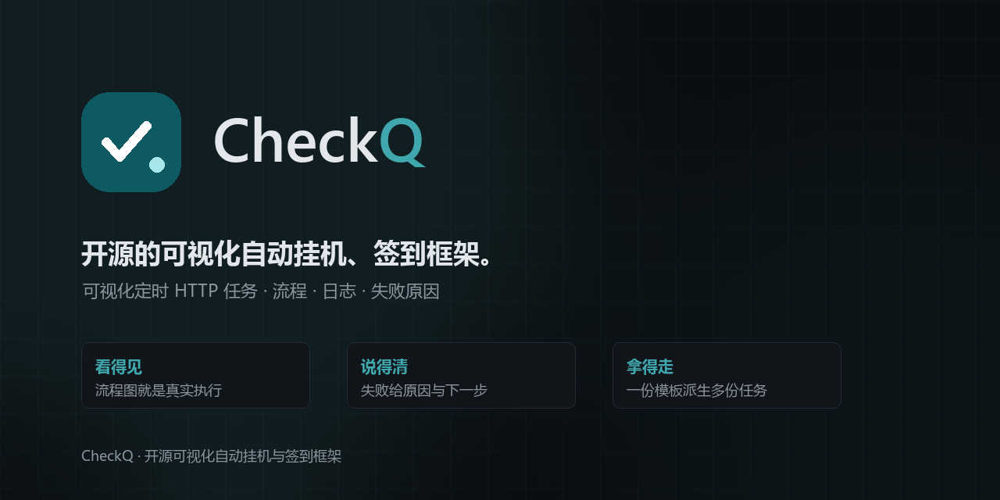

<p align="center"><a href="https://zqs1qiwan.github.io/checkq/"></a></p>

<h1 align="center">CheckQ</h1>

<p align="center"><strong>开源的可视化自动挂机、签到框架</strong></p>

<p align="center"><a href="https://zqs1qiwan.github.io/checkq/">文档</a> · <a href="#快速开始">快速开始</a> · <a href="https://github.com/zqs1qiwan/checkq/issues">Issues</a></p>

<p align="center"></p>

CheckQ 把签到、打卡、查询、监控、上报这类重复 HTTP 操作做成可视化流程：拖拽积木搭建，导入 HAR 自动生成，定时执行，失败能看到原因。Docker 单容器部署，数据落在本地 `/data`。不内置浏览器渲染、验证码识别、多语言运行时与集群能力；需要时请用外部服务。

## 文档

- 文档站：<https://zqs1qiwan.github.io/checkq/>
- 开发文档：`docs/ARCHITECTURE.md`、`docs/UI-STANDARDS.md`、`docs/API.md`、`docs/MCP.md`
- 更新日志：`docs/CHANGELOG.md`
- 仓库只放框架，具体站点流程 / 模板不入库

## 特性

- **可视化流程** — HTTP、条件、赋值、提取、延迟、循环、脚本、日志、通知九类节点，拖拽连线即可搭建
- **导入即用** — 支持浏览器 HAR、cURL 和 QD 模板导入，自动生成可编辑流程
- **模板与批量** — 流程存为模板，变量各自填写；支持 JSON 导出、CSV 批量创建任务和模板市场索引
- **调度与重试** — 每个任务独立 cron / 时区 / 抖动；失败按指数退避重试，连续失败自动停用，可选恢复探测
- **失败可解释** — 九类诊断给出原因与下一步；日志完整记录请求、响应、断言、耗时和变量快照
- **运行可见** — 实时运行抽屉、连续日志、日志与画布双向定位；单次运行可导出脱敏 HAR
- **安全** — 多用户角色、TOTP 两步验证、会话吊销、API Key 只存摘要、敏感凭据加密落盘
- **通知** — 12 种渠道（站内 / Webhook / Bark / Telegram / Server酱 / PushPlus / 钉钉 / 企业微信 / 飞书 / Gotify / ntfy / SMTP），支持任务通知与每日汇总
- **任务管理** — 分组、折叠、批量操作、今日成功率、本机统计
- **部署** — Docker 单容器，零数据库依赖，数据落在 `/data`

## 快速开始

```bash
mkdir checkq && cd checkq
curl -O https://raw.githubusercontent.com/zqs1qiwan/checkq/main/docker-compose.yml
# 或克隆本仓库后:
docker compose up -d --build
```

```yaml
# docker-compose.yml
services:
  checkq:
    build: .
    ports:
      - "18888:8888"
    environment:
      - ADMIN_PASSWORD=changeme        # 首次登录密码（不设则自动生成并打印到容器日志）
      - TZ=Asia/Shanghai
    volumes:
      - ./data:/data
```

打开 `http://localhost:18888`，新建空白流程拖拽搭建，或导入 HAR / JSON。

> 端口口径：服务端默认监听 **8888**（`server/src/index.js` 的 `PORT||8888`、Dockerfile `EXPOSE 8888`）。上面这份 `docker-compose.yml` 把宿主 **18888** 映射到容器 8888，只是本地测试方便、避开本机已有的 8888；生产直连请用 `docker-compose.prod.yml`（`8888:8888`），访问 `http://localhost:8888`。`tools/deploy-prebuilt.sh` 会依次探测 8888 / 18888，也可用 `CHECKQ_PORT` 显式指定宿主端口。

## 流程步骤类型

| 类型 | 作用 |
|---|---|
| HTTP | 发请求，模板化 URL/头/体，断言成功/失败，保存响应；可选 `fetch` 或 `curl` 执行后端（curl 用于绕开对 Node fetch TLS 指纹的风控） |
| 条件 | jexl 表达式判断，真/假两个分支出口 |
| 赋值 | 文本模板或表达式计算 → 写入变量 |
| 提取 | 正则从响应体/状态码/响应头提取 → 变量 |
| 延迟 | 等待 N 秒 |
| 日志 | 输出信息到运行日志 |
| 通知 | 节点内推送（Webhook / Telegram / Bark）；任务级通知渠道共 12 种，在编辑器「通知渠道」里配置 |

变量模板语法：`{{var}}`、`{{user.email}}`，缺变量渲染为空并在日志记录缺失名。

## API

除 `/api/login`、`/api/health`、`/api`、`/api/openapi.json`、`/api/system/bootstrap`、`/api/me` 外，所有 `/api/*` 需登录 cookie 或 `X-API-Key`。

| 方法 | 路径 | 说明 |
|---|---|---|
| POST | /api/login | 登录 |
| GET/POST | /api/flows | 列表 / 新建 |
| GET/PUT/DELETE | /api/flows/:id | 详情 / 保存 / 删除 |
| POST | /api/flows/:id/run | 立即运行（可选 `debugStopId` 调试到指定节点） |
| GET | /api/runs?flowId= | 运行历史 |
| GET | /api/runs/:id | 单次运行详情 |
| POST | /api/import/har | HAR/QD 模板导入 → 流程草稿（QD `retry_count/retry_interval` 自动映射为 http 节点 `retry`） |
| POST | /api/import/curl | cURL 命令解析 → HTTP 节点配置 |
| GET/POST | /api/templates | 模板列表 / JSON 导入建模板 |
| GET/PUT/DELETE | /api/templates/:id | 模板详情 / 改名改变量 / 删除（不影响已建任务） |
| POST | /api/templates/from-flow/:flowId | 流程另存为模板（敏感变量脱敏导出） |
| POST | /api/templates/:id/instantiate | 实例化 → 新任务（克隆节点图 + 变量合并） |
| POST | /api/flows/batch | 批量动作 `{ action: run\|enable\|disable\|delete\|set-group, ids }`（CSV 批量建任务见 `/api/templates/:id/instantiate-csv`） |

## 开发

```bash
# server
cd server && npm install && npm run dev
# web (另开终端)
cd web && npm install && npm run dev   # http://localhost:5173，/api 代理到 8888
# 单测
cd server && node test/engine.test.js && node test/engine-v02.test.js && node test/curl-import.test.js && node test/logging.test.js
# 全量单测
cd server && for f in test/*.test.js; do node $f; done
# 前端规范（生成本地 .agents/skills，不入库）
npx modern-web-guidance@latest install
```

质量护栏（都可用本地命令跑，命中即 exit 1）：

| 工具 | 作用 |
|---|---|
| `node tools/ui-smoke.cjs <baseUrl>` | UI 冒烟检查：无依赖 CDP 驱动真实浏览器，按 7 种视口 × 明暗主题逐项体检（横向溢出 / 顶栏重叠 / 图标按钮框 / 下拉菜单被裁 / 弹窗 ✕·Esc·滚动锁·居中 / 页面出现 undefined·NaN / 控制台报错） |
| `node tools/ui-interaction-audit.cjs <baseUrl>` | 全量交互巡检：9 视口 × 明暗主题，逐项核对顶栏单行等高、工具条分组、弹窗居中、设置分区、任务详情、模板页、移动端「更多」、编辑器画布/MiniMap/更多菜单 |
| `node tools/verify-round.cjs <baseUrl>` | 一轮全量验收执行器：构建 → 服务端全量单测 → 3 个审计 → UI 冒烟 → 交互巡检，输出本轮汇总（验收口径见 `docs/PRD.md` §11.2） |
| `node tools/copy-audit.cjs` | 文案金标准审计：无常驻说明性文字、无说明性副标题、label 无括号说明 |
| `node tools/secret-scan.cjs` | 秘密扫描：工作区 + 完整 git 历史的高危凭据 + 仓库内容政策（私有词表本地留存，不入库） |
| `node tools/project-audit.cjs` | 项目一致性：相对 import、文档链接、wiki 页面来源、API 端点、MCP 工具、CSS 契约与陈旧交互说法 |

UI 冒烟检查需要先起一个本地实例（默认 `http://localhost:19998`）：

```bash
cd server && PORT=19998 DATA_DIR=/tmp/cq-ui ADMIN_PASSWORD=test1234 node src/index.js
node tools/ui-smoke.cjs http://localhost:19998
```

技术栈：Fastify / React 18 / @xyflow/react / jexl / croner。零数据库依赖，数据落在 `/data`（flows.json、runs.json、templates.json、meta.json、notifications.json）。

## License

MIT
