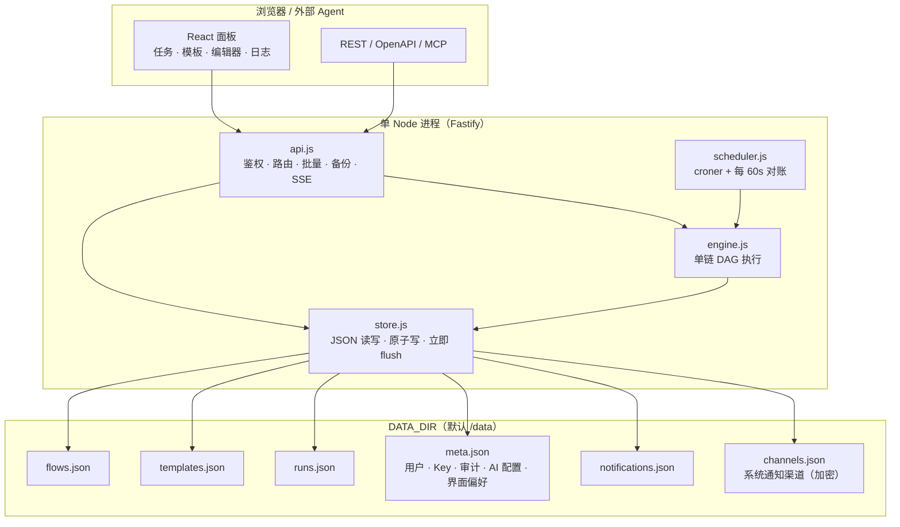

# CheckQ 架构与开发指南

> 面向第一次接触本仓库的开发者和 Agent。读完这一篇应当能回答四个问题：
> **产品是什么、代码在哪、哪些规则不能碰、加一个能力要改哪几个文件。**
> 产品决策与本期范围以 `docs/PRD.md` 为准；本文只讲"怎么实现、怎么不破坏"。

---

## 0. 先花 3 分钟理解产品方向

**一句话**：给"会用浏览器、但不想写脚本"的人，一个把「每天点一下」变成「看得见、说得清、能复用」的 HTTP 自动化工作台。

**三条承诺**（任何改动都不应该让它们变弱）：

| 承诺 | 含义 | 反例（不要做） |
|---|---|---|
| 看得见 | 流程图等于真实执行：分支、循环、失败都在图上 | 让流程在图上"悄悄结束"却不提示 |
| 说得清 | 失败要能给出原因与下一步 | 只把原始响应丢给用户 |
| 拿得走 | 模板 = 流程 + 各自参数，能复用、能分发 | 把模板做成一次性复制品 |

**已交付的六项基础能力**：演练场、结构可见、可解释失败、修改即重跑、模板市场 v1、度量最小版。交付记录见 `docs/PRD.md` §5；下一阶段见 §9。

**明确的非目标**（不要顺手加）：

- 无头浏览器 / Playwright、验证码识别；
- Python / Shell / TypeScript 运行时；
- 集群 / 分布式 / 多租户；
- 内置业务模板（仓库里只放框架，具体站点流程属于用户自己的数据）。

> 想加非目标里的东西，先回 `docs/PRD.md` §0.4 与 §3.5 看重估条件，再开产品决策，不要直接写代码。

**文档地图**

| 文档 | 回答什么 | 谁看 |
|---|---|---|
| `docs/PRD.md` | 产品定位、用户、范围、本期需求、路线、验收 | 所有人，先读 §0 一页结论 |
| `docs/ARCHITECTURE.md`（本文） | 架构、数据模型、模块职责、扩展点、不变量 | 开发 / Agent |
| `docs/UI-STANDARDS.md` | 界面与交互金标准（令牌、组件、画布语义、文案、响应式、护栏） | 前端 / 设计 / 评审 |
| `docs/API.md` / `docs/MCP.md` / `docs/AGENT-ACCESS.md` | 对外接口、MCP 工具集、外部 Agent 接入姿势 | 集成方 |
| `docs/SECURITY.md` / `docs/STORAGE-BACKUP.md` | 安全模型、数据与备份 | 运维 / 安全 |
| `docs/QIANDAO-COMPAT.md` | QD 模板导入的映射规则 | 做兼容的人 |
| `docs/COMPETITIVE-ANALYSIS.md` | 竞品**事实**（判断在 PRD §3） | 做选型/复盘的人 |
| `docs/TEMPLATE-MARKET.md` | 模板索引协议 v1（含校验与导入行为） | 做市场/导入的人 |
| `docs/AI-ASSIST.md` | 快速组装与 AI 助手的边界 | 碰向导/模型的人 |
| `docs/ROADMAP.md` | v0.4 及以前的版本历史 | 查历史（下一阶段看 PRD §9） |
| `docs/CHANGELOG.md` | 用户视角更新日志 | 发布时 |

---

## 1. 运行时架构



**启动链路**：`server/src/index.js` → `PORT || 8888`、`DATA_DIR || /data` → `api.startServer()` → 挂鉴权/路由/静态资源/调度器。

**一次运行**：

1. `POST /api/flows/:id/run`（或 cron 触发）→ `api.js` 先创建 `runId` 与 `queued` 记录并落库（在途可见），再把任务放进**同任务串行队列**，再由全局并发限制器（`CHECKQ_MAX_CONCURRENCY`，默认 4）分配执行名额。两级队列按到达顺序分配，均响应 `activeRuns` 持有的 `AbortController`。取消排队时立即移除该运行并返回取消结果，同一任务的其他排队记录继续等待。
2. `retry.js` 按任务级策略执行整条流程：每次尝试跑一个完整的 `Engine.run()`，失败则退避后再来，跑满 `maxAttempts` 才判最终失败；每次尝试都带同一个 `signal`，取消时不进入下一次退避。
3. `engine.js` 从无入边的起点沿边单链执行，`MAX_STEPS = 500`；每步产出 `stepLog`（请求/响应/断言/耗时/变量快照）。HTTP fetch/curl、delay、random-delay、script 子进程和 foreach 都检查 `signal`，取消时尽快退出。
4. `store.js` 即时原子写入变更。运行状态和通知结果只更新 `runs.json`，站内通知只更新 `notifications.json`。`run.notify` 记录每个渠道的发送结果，外部渠道全失败时另写一条站内告警。整体超时默认 30 分钟（`CHECKQ_RUN_TIMEOUT_MS` 或 `timeoutMs`），超时按 `failed + timedOut`，人工取消按 `cancelled`（不触发自动停用与任务通知）。
5. 自动停用：调度触发的运行失败后，`auto-pause.js` 写 `enabled=false + pausedAt/pausedReason`；若任务开启 `recovery`，同时排下一次探测。
6. 恢复探测：`scheduler.js` 每 60s 扫描「已暂停 + recovery.enabled」的任务，到点以 `trigger='probe'`、`{ notify:false }` 调用 `runFlow`；成功自动启用，失败累计次数，达到上限停止。探测关闭任务级重试，一次探测只跑一次。
7. 若请求带 `stream: true`，同上过程通过 SSE 推 `start（含 runId） / log / done`；`POST /api/runs/:id/cancel` 可在另一条请求里中断这次运行。

**重启对账**：`Store` 初始化时扫描已落盘的运行历史，将 `queued` / `running` 收束为 `failed` + `interrupted: true`，保留已有日志并追加一条原因说明。仅当有遗留记录时原子写回 `runs.json`。此路径不经过执行器、通知或自动停用逻辑。

**存储**：六个 JSON 文件，全量读写；没有数据库、没有外部依赖。这就是"零依赖"的来源，也是容量上限的来源。`flows.json`、`templates.json`、`channels.json` 共用 AES-256-GCM 密钥；`meta.json` 的 AI Key 与旧 API Key 也走同一加密（内存明文、落盘密文）。

**出口安全**：运行日志在写入 `runs.json` 和 SSE 推送前统一经过 `redact.js`；默认备份、任务/模板导出也走同一套脱敏。执行状态（`state.vars` / `last`）保留原值，脱敏只发生在对外出口。

**客户端 IP**：默认只信任本机/私有网段来源的 `X-Forwarded-For`；`CHECKQ_TRUST_PROXY=1` 全信任、`=0` 不信任、其他值按 CIDR 列表匹配连接来源（见 `api.js clientIp`）。

---

## 2. 数据模型

> 完整字段以 `server/src/model.js` 与 `server/src/store.js` 为准；这里只列"改代码必须知道"的部分。

### 2.1 对象

| 对象 | 位置 | 关键字段 | 注意 |
|---|---|---|---|
| Flow（任务） | `flows.json` | `id, name, note, group, cron, timezone, enabled, vars, notify, log, retry, recovery, jitterMinutes, pausedAt, pausedReason, tplId, nodes, edges, rev` | 派生任务（`tplId`）读时取模板当前流程图；`recovery` 默认关闭，含探测配置与运行态；`rev` 每次保存递增，用于并发编辑冲突检测 |
| Node | `Flow.nodes[]` | `id, type, x, y, name, config` | `type` 必须是 `STEP_TYPES` 的键 |
| Edge | `Flow.edges[]` | `id, source, sourceHandle, target` | `sourceHandle` 决定走哪条出口 |
| Template | `templates.json` | `id, name, desc, vars, nodes, edges, log` + 派生计数 | 不含调度与真实凭据 |
| Run | `runs.json` | `id, flowId, trigger, status, logs[], vars, finalMessage, durationMs, attempts[], notify, recovery` | 每任务保留上限 500 条；`notify` = `{ total, ok, failed[] }`；`trigger='probe'` 时 `recovery` = `{ attempt, maxAttempts, outcome, exhausted }` |
| meta | `meta.json` | 用户、角色、会话、API Key 摘要、审计、AI 配置、界面偏好、每日汇总配置 | 密码只存 hash；`ai.apiKey` 与旧 `apiKey` 落盘加密 |
| 通知 | `notifications.json` | 站内通知，上限 200 | 未读角标从这来 |
| 系统渠道 | `channels.json` | `{ version, system: [...] }`；`system` 恒含一条 `inbox`，外部渠道最多 10 条 | 独立于任务，任务停用/删除不影响；敏感字段落盘加密、API 返回明文、备份默认脱敏 |

### 2.2 出口（handle）语义——这是引擎的硬约定

| 节点类型 | 出口 | 含义 |
|---|---|---|
| `http` | `success` / `failed` | 断言与网络都通过 / 否则 |
| `condition` | `true` / `false` | jexl 表达式真假 |
| `foreach` | `each` / `next` | 循环体入口 / 循环结束后的后继 |
| 其它 | `next` | 唯一出口 |

**未连线时的行为（务必记住）**：`failed` 出口没接线 → 判运行失败；接了线 → 沿失败分支继续执行。`true` / `false` / `next` 出口没接线 → **链路结束并判为正常完成**（`engine.js` 明确如此）。v0.5 的 P0-2 会加"缺线提示 + 保存检查清单"，但**不改变执行语义**——要改语义必须先开产品决策。

### 2.3 变量与渲染

- `vars`：流程级 KV；模板默认值 + 任务覆盖；运行中节点可写。
- 渲染：`{{var}}`、`{{user.email}}`、函数式白名单（`md5(...)`、`timestamp('float')` 等）+ 过滤器（`|upper`、`|default('x')`），实现在 `render.js`，**没有 eval**。
- 表达式：jexl（`condition`、`set` 的 `=` 前缀、断言）。
- 上下文：`vars` / `last`（上一步响应：`status/text/json/headers/setCookies`）/ `steps.<nodeId>`。
- 缺失变量会被收集（`missing`），日志与变量面板会提示。

---

## 3. 模块地图

### 3.1 服务端 `server/src/`

| 文件 | 职责 | 改动风险 |
|---|---|---|
| `index.js` | 启动、端口、数据目录 | 低 |
| `api.js` | 所有路由、鉴权、批量、备份恢复、SSE、运行队列 | **高**（约 96KB，改前先读相关段） |
| `engine.js` | 节点执行、断言、cookie 罐接入、日志过滤、foreach | **高**（执行语义的唯一事实源） |
| `script-runner.cjs` | `script` 节点隔离子进程（内存/时长/输入/输出上限） | 中（安全边界） |
| `model.js` | `STEP_TYPES`、`validateFlow` | 中（前后端共用） |
| `store.js` | JSON 持久化、模板解析、统计、脱敏出口 | **高**（数据一致性） |
| `scheduler.js` | croner 调度、抖动、跳过重叠、恢复探测对账 | 中 |
| `retry.js` | 任务级退避执行器、配置归一化 | 中 |
| `auto-pause.js` | 调度失败自动停用；`probe` 永不触发停用 | 中 |
| `recovery.js` | 恢复探测配置/运行态归一化、到点判定、成功/失败状态迁移 | 低（纯函数） |
| `render.js` | 模板渲染、白名单函数、过滤器 | 中（安全边界） |
| `cookiejar.js` | run 级 cookie 罐 | 中 |
| `har-import.js` / `curl-import.js` / `har-export.js` | 导入导出 | 中（格式兼容） |
| `auth.js` / `totp.js` / `secret.js` | 登录、2FA、凭据加密 | **高**（安全） |
| `redact.js` | 日志/导出统一脱敏：URL、headers、body、动态值、Set-Cookie（纯函数） | 中（所有日志出口都走这里） |
| `iprange.js` / `sensitive-name.js` / `text-regex.js` | 小工具（部分前后端共用） | 低 |
| `notify.js` | 12 类通知渠道的唯一发送出口（统一超时、并行、返回结构） | 中（所有通知都走这里） |
| `concurrency.js` | 全局并发限制器（默认 4，可环境变量覆盖） | 低（纯函数） |
| `openapi.js` / `version.js` | OpenAPI 描述、版本单源 | 低 |

### 3.2 前端 `web/src/`

| 路径 | 职责 |
|---|---|
| `App.jsx` / `main.jsx` | 壳、路由级状态 |
| `api.js` | 后端调用封装（无 body 请求不带 content-type） |
| `stepTypes.js` | 复用 `server/src/model.js` 的 `STEP_TYPES` + `defaultConfig` + 出口文案 |
| `layout.js` | 画布"整理"的 DAG 分层布局 |
| `confirm.jsx` / `toast.js` / `theme.js` / `util.js` | 确认弹窗、提示条、主题、通用工具（含渠道清单） |
| `styles.css` | 设计令牌与全部样式（令牌在 `:root`） |
| `components/FlowList.jsx` + `flow-list/` | 首页：任务表、分组、模板 Tab、向导、设置、各类弹窗 |
| `components/FlowEditor.jsx` + `editor/` | 编辑器：画布、调色板、配置面板入口、运行、调度、各类弹窗 |
| `components/RunDrawer.jsx` / `LogStream.jsx` | 运行抽屉、连续日志流（唯一证据入口） |
| `components/PickPanel.jsx` | 点选即逻辑（JSON 树 / 文本划选 → 节点） |
| `components/TaskDetailModal.jsx` | 任务详情（首页与编辑器共用同一组件） |
| `components/RecoveryFields.jsx` | 自动恢复探测控件（任务详情与调度弹窗共用） |
| `components/Logo.jsx` | 品牌标志组件（徽章 + 字标；顶栏 / 登录 / 加载 / 空状态共用） |
| `web/public/brand/` + `web/public/favicon*` | 品牌 SVG、favicon、apple-touch-icon；构建时原样发布 |
| `components/Modal.jsx` / `Dropdown.jsx` / `Icons.jsx` | 基础交互组件与线性图标 |

### 3.3 其它

| 路径 | 职责 |
|---|---|
| `mcp/checkq-mcp.cjs` | stdio MCP server，20 个工具，面向外部 Agent |
| `tools/` | 机械护栏与构建脚本（见 §6） |
| `wiki/` + `tools/build-wiki.cjs` | 由 `docs/` 生成的用户文档站（不得含内部内容） |
| `.github/workflows/` | CI（单测 + 前端构建 + 文案/一致性）；Pages 发布 wiki |

---

## 4. 不变量（改动前先确认自己没有破坏它们）

1. **出口约定**：handle 名字与 `STEP_TYPES[type].outputs` 一致；新增出口要同时改 `engine.js` 的 `nextNodeId` 调用点与配置面板。
2. **缺线语义**：`failed` 未接 = 失败；其它未接 = 正常完成。改语义 = 产品决策。
3. **模板跟随**：读时取模板（`store.resolveFlow`）；`PUT` 时用 `sameLogic`（忽略坐标）判断脚本是否被改，改了则脱钩并返回 `detached`。不要在任务里存模板的副本做"同步"。
4. **凭据**：新增任何落盘字段，若可能含凭据，必须走 `secret.js` 加密；新增任何日志/导出字段，必须走 `redact.js` 脱敏。执行内部保留原值，只在写盘/SSE/备份/导出出口脱敏。
5. **单任务串行**：同一 flow 同时只跑一个；调度触发时若上次未结束则跳过这一拍。
6. **日志唯一入口**：任务行「日志」、状态徽章、运行结束提示都打开同一个连续日志流。
7. **持久化**：新增数据一律走 `store.js`，保持"原子写 + 变更立即 flush + 进程退出 flush"。
8. **共享模块不复制**：`model.js`、`sensitive-name.js`、`text-regex.js`、`flow-list/wizard-logic.js` 前后端/测试共用同一份。
9. **版本单源**：运行时代码从 `version.js` 取版本，文档不写死版本号；三处 `package.json` 必须一致。
10. **文案零常驻说明**：解释放悬停（`title`），不写副标题式说教（`copy-audit` 会拦）。
11. **恢复探测默认关闭**：`recovery.enabled` 不得默认 true；`trigger='probe'` 不得触发自动停用，也不得发送任务通知。
12. **运行生命周期**：排队/运行中的 Run 必须先落库；取消走 `AbortController`，所有可等待步骤（HTTP、curl、delay、重试退避、脚本子进程）都要响应 `signal`；取消不得触发自动停用或任务通知。
13. **脚本隔离**：`script` 不得回到服务端主进程执行；必须经 `script-runner.cjs` 子进程（内存/时长/脚本/结果上限），父进程只传 JSON 快照、只收 JSON 结果。

---

## 5. 扩展指南

### 5.1 新增一种节点类型

顺序别乱，少一步就会出现"能存不能跑"或"能跑不能配"：

1. `server/src/model.js`：`STEP_TYPES` 加条目（`label`、`color`、`outputs`）。
2. `server/src/engine.js`：`execNode` 的 `switch` 加 `case`；定义成功/失败返回与 `handle`。
3. `server/src/model.js`：如需要，扩展 `validateFlow` 的成环/起点校验（例如循环回边例外）。
4. `web/src/stepTypes.js`：`defaultConfig(type)` 给默认配置（保证拖进来就能跑）。
5. `web/src/components/ConfigPanel.jsx`：加配置表单（字段即时校验、错误提示）。
6. `web/src/components/FlowEditor.jsx`：调色板直接遍历 `STEP_TYPES`，通常不用改；若需要分组/图标再动。
7. 测试：`server/test/engine-v02.test.js` 或新建用例（成功 + 失败 + 边界）。
8. 若节点会写变量或调网络，确认脱敏与超时。

### 5.2 新增通知渠道

1. `server/src/notify.js`：发送实现（错误必须返回可读消息；不要另建第二套 fetch）。
2. `web/src/util.js`：`CHANNEL_TYPE_OPTIONS` 加一项（短名与字段），`CHANNEL_LABELS` 自动派生，**不要另建清单**。
3. `web/src/components/editor/modals.jsx`：渠道卡片字段（按类型动态显示）。
4. `docs/PRD.md` §2.1（能力矩阵）与 `README.md` 特性列表同步。
5. 测试：`server/test/notify.test.js` 加用例（成功 + 失败）。

### 5.3 新增导入格式 / 导出

- 导入器放 `server/src/`（如 `har-import.js`），输出**草稿流程**而不是直接落库；前端只负责选择与预览。
- 兼容规则写进 `docs/QIANDAO-COMPAT.md` 或对应文档，并补单测。
- 导出默认脱敏（cookie/token/密码 → `***`）。

### 5.4 新增诊断规则（v0.5 起）

- 规则写在 `server/src/diagnose.js`（纯函数，输入 `stepLog + flow`，输出 `{cause, confidence, evidence[], actions[]}`）。
- 必须配一条 fixture（脱敏）并进 `tools/diagnose-replay.cjs` 回放。
- 动作只能是白名单里"可执行、可撤销"的配置变更；**不得自动改流程、不得自动重跑、不得调用模型**。
- 低置信（证据不足）只允许输出"看这里"，不给按钮。

### 5.5 新增 API 端点

1. `server/src/api.js`：路由 + 鉴权（默认要求登录或 `X-API-Key`；写操作同源）。
2. `server/src/openapi.js`：补描述（`api-surface.test.js` 会核对公开端点）。
3. `docs/API.md`：补路径与参数。
4. 若有新错误分支，返回中文 `{ error }`。

### 5.6 新增 MCP 工具

1. `mcp/checkq-mcp.cjs`：注册工具与参数 schema。
2. `docs/MCP.md`：表格补一行（`project-audit` 会核对文档与实现一致）。
3. 只暴露框架能力，不要内置业务逻辑。

### 5.7 新增持久化字段

- 新字段必须有默认值（老数据无该字段时要能跑）。
- 若要迁移，写在 `store.js` 的加载阶段（幂等），不要写一次性脚本进运行时。
- 更新 `docs/STORAGE-BACKUP.md`，并确认备份/恢复不会丢字段。

---

## 6. 验收命令

```bash
# 全量单测
node --test "server/test/*.test.js"

# 前端构建
npm run build
node tools/copy-web.cjs

# 三个静态审计
node tools/project-audit.cjs
node tools/copy-audit.cjs
node tools/secret-scan.cjs
node tools/diagnose-replay.cjs

# 起一个本地实例（另开终端；DATA_DIR 指向任意空目录）
cd server
PORT=19998 DATA_DIR=/tmp/cq-ui node src/index.js   # 不设 ADMIN_PASSWORD 时首启自动生成并打印到日志

# 浏览器类检查（需要上一步的实例）
node tools/seed-demo-instance.cjs http://localhost:19998
node tools/ui-smoke.cjs http://localhost:19998
node tools/ui-interaction-audit.cjs http://localhost:19998

# 一轮全量验收（构建 + 单测 + 三审计 + 冒烟 + 交互巡检）
node tools/verify-round.cjs http://localhost:19998
```

CI（`.github/workflows/ci.yml`）跑单测 + 前端构建 + 文案/项目一致性；浏览器类巡检由本地 `verify-round` 负责。

---

## 7. 性能与容量现状

| 项 | 现状 | 含义 |
|---|---|---|
| 存储 | 六个 JSON 文件全量读写 | 小体量舒服；`runs` 到上万条后会变慢 → 分段/归档是后续插队项 |
| 执行 | 单链、`foreach` 串行、`MAX_STEPS 500` | 适合有状态链路；不适合海量并行抓取 |
| 队列 | 同任务串行；跨任务并行但受全局上限约束（默认 4） | 排期洪峰不会同时打满出口；上限用 `CHECKQ_MAX_CONCURRENCY` 调 |
| 前端 | 单页、`content-visibility` 处理长日志 | 长日志不卡；画布到数十节点需要折叠与大纲 |
| 目标 | 2 核 1GB 稳定跑约 100 个任务（设计目标，未做压测） | 超过这个量级先补度量再谈优化 |

---

## 8. 常见坑

- **Fastify 空体请求**：无 body 的请求不要带 `content-type`，否则 400（前端 `api.js` 已处理）。
- **弹窗高度**：`dialog.modal[open]` 必须 `height: fit-content`；`height: auto` 会被 `inset: 0` 拉满再截断。
- **弹窗里的菜单**：Popover 必须挂到该 `<dialog>` 内部，否则被 `inert` 拦住点不到。
- **边没有 handle**：`nextNodeId` 先找精确 handle，再退回空 handle 的边；手写流程时别依赖这个兜底。
- **foreach 循环体**：靠"从 `each` 走到 `next` 后继"判定，循环体里不要接回主链，否则会提前结束本轮。
- **模板删除**：派生任务回退到自己存的最后一份流程，照常能跑——不要当成数据损坏去"修"。
- **日志档位**：`record=log` 只出 log 节点（+失败步骤）；流程没有 log 节点会自动退回全部步骤，避免空白。
- **重试期间**：调度会跳过这一拍，别把它当成"漏跑"。
- **Windows 本地跑测试**：用 `node --test "server/test/*.test.js"`（带引号的 glob）；`node --test test/` 会把目录当模块报错。

---

## 9. 下一步（架构层面的待办）

1. `FlowEditor.jsx`（722 行）/ `FlowList.jsx`（698 行）/ `api.js`（98KB，2034 行）仍偏大：下次大改前先把画布交互与日志联动抽到 `web/src/hooks/`。
2. `diagnose.js` 必须是纯函数（可单测、可回放），不要直接依赖 `store`。
3. 结构可见（循环容器）只能是**渲染层分组**，不得改变 `nodes/edges` 数据，否则旧流程会位移。
4. 度量（`/api/system/metrics`）只做聚合派生，不新增敏感字段。

> 产品顺序与退出条件见 `docs/PRD.md` §5 与 §9；本文与它冲突时，以 PRD 的产品决策为准，架构约束以本文为准。
