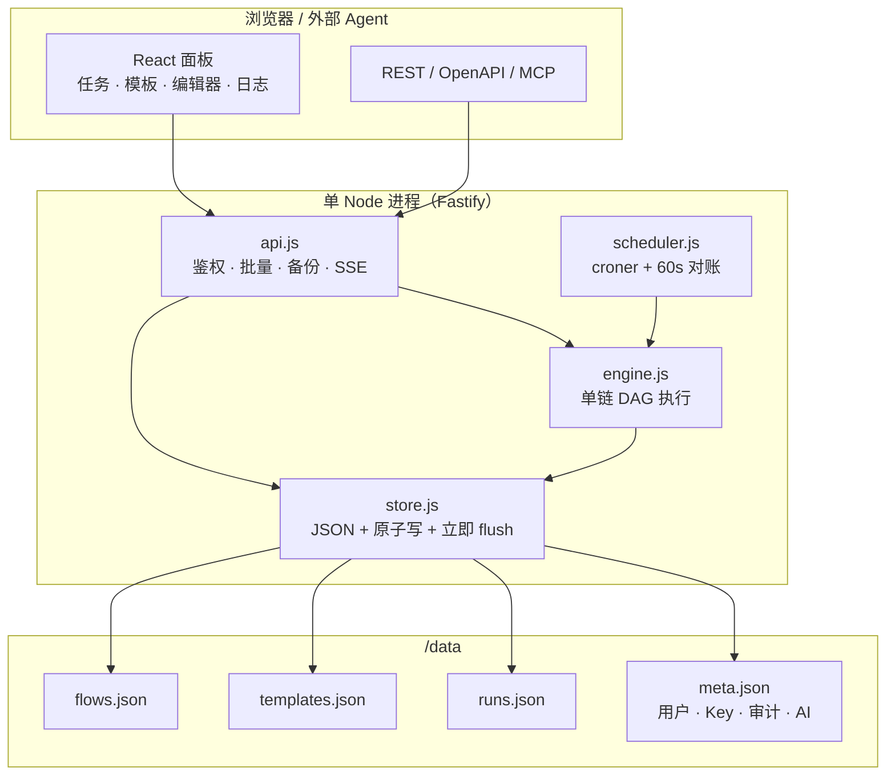
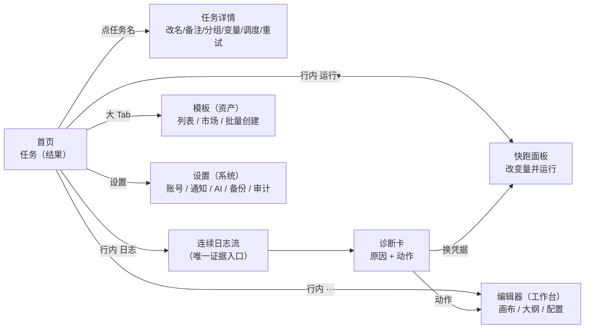
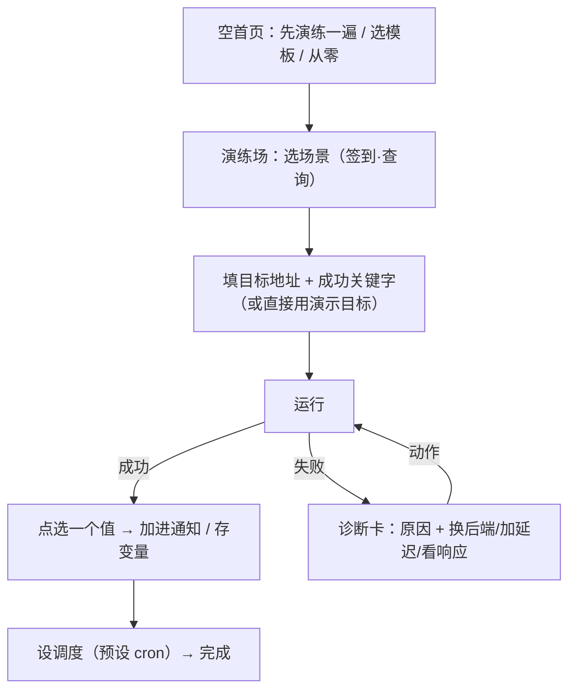
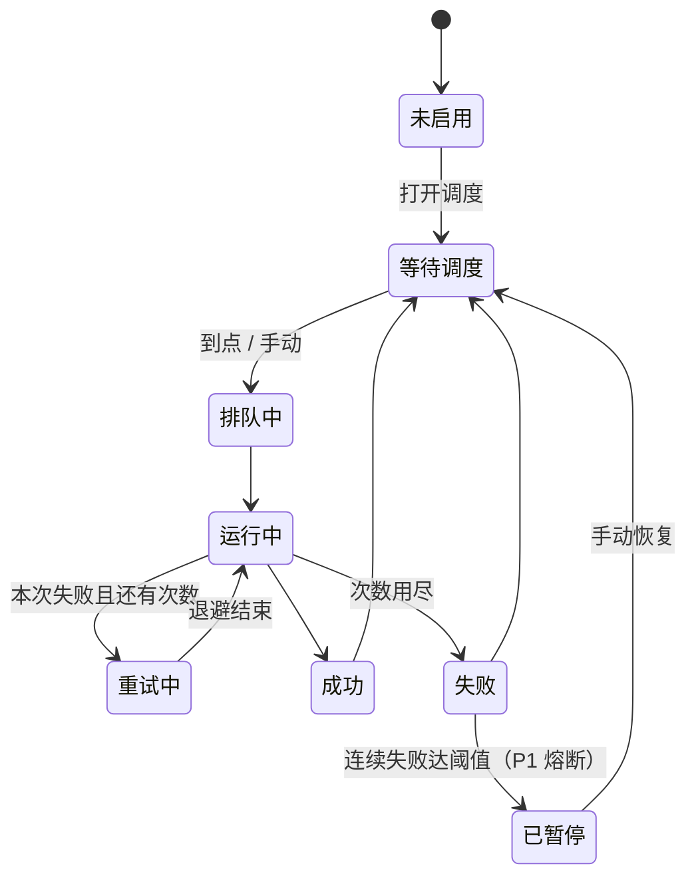
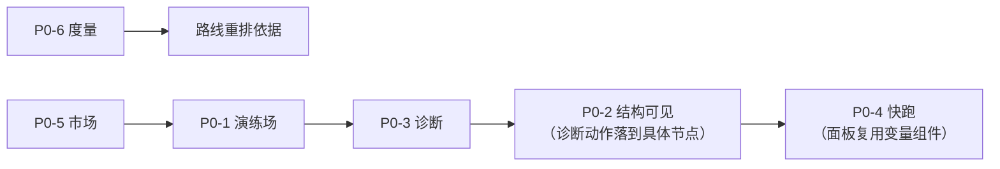
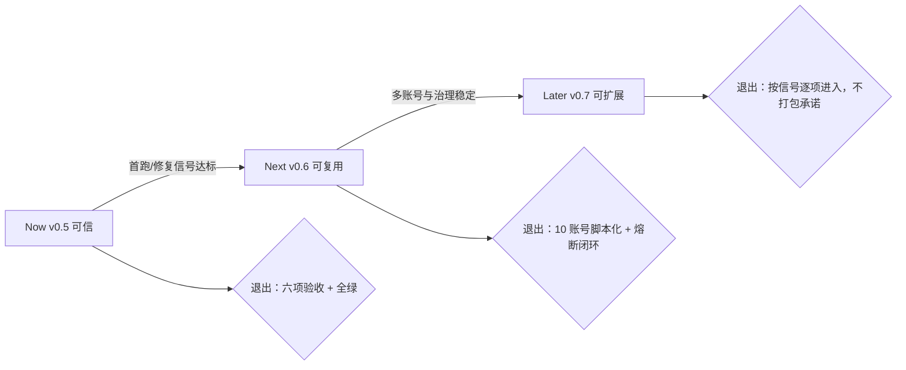

# CheckQ 产品规划（v0.5 · 2026-11）

> **本文已合并（2026-11-15）**：产品决策、需求、路线与验收已整体并入 `docs/PRD.md`。本文件仅作为当时的规划稿保留，**不再更新**；任何冲突以 `docs/PRD.md` 为准。
>
> 状态：历史规划稿 · 日期：2026-11-15
> 依据：本仓库代码与文档实读（`server/src`、`web/src`、`docs/`、`tools/`）+ 两个对标项目公开 README 与文档站（同日访问）
> 本文回答三件事：**我们是谁、这一版做什么、接下来按什么顺序做**。

---

## 0. 一页结论

### 0.1 定位一句话

> **给"会用浏览器、但不想写脚本"的人，一个把「每天点一下」变成「看得见、说得清、能复用」的 HTTP 自动化工作台。**

三个承诺对应三块可被验证的能力，而不是三句形容词：

| 承诺 | 用户能感知到的事实 | 现在差在哪 |
|---|---|---|
| **看得见** | 流程图就是真实执行：分支、循环、失败都在图上，图不骗人 | 循环体范围不可见、未连线的出口没有提示（§1.2.1） |
| **说得清** | 失败给出「原因 + 下一步动作」，不是一堆原始响应 | 只有错误分类（network/assert/engine），没有原因与建议（§1.2.2） |
| **拿得走** | 模板能找、能验、能一键变成任务，一模板多账号 | 模板机制强，但没有可浏览的市场与版本（§1.2.3） |

### 0.2 三个判断（这是本文与现有文档最不一样的地方）

1. **不要再讲"功能比谁多"，要讲"从想法到稳定运行的路径更短"。**
   在引擎与交互这一层，CheckQ 已经不弱于 QD（10 种节点、双层重试、cookie 罐、模板实参分离、12 渠道、MCP 20 工具），但这些是"看代码才知道"的优势。用户能感知的只有两件事：**第一次成功要多久**、**坏了多久能修好**。
2. **"可视化"目前只做到"节点可见"，没做到"结构可见"。**
   图能画出来，不等于图能自解释。当前画布最大的风险不是不好看，而是**它会说谎**：条件分支的真/假出口没连线时，流程就在那里结束，并被判定为"正常完成"（`engine.js` 对此有显式分支），后续步骤从未执行（§1.2.1）。对可视化产品，这是致命的信任问题。
3. **最大的产品风险不是功能缺口，是没有度量。**
   仓库里没有任何使用数据采集。所有优先级都来自开发者体感和历史 PRD。先建立最小度量，再谈路线取舍（§7.6、§9.7）。

### 0.3 本期（v0.5.0「可信」）只做六件事

| 编号 | 事项 | 为什么现在 |
|---|---|---|
| P0-1 | **演练场**：内置演示端点 + 一条演练模板，空实例 5 分钟跑通一次 | 新用户没有能安全试错的目标，是首跑流失的结构性原因 |
| P0-2 | **结构可见**：出口缺线提示、分支边标注、循环体容器、大纲视图 | 修掉"图说谎"，这是可视化定位的地基 |
| P0-3 | **可解释失败**：规则诊断器 + 可执行动作 | 成本最低、差异最大的一环；竞品都只给原始日志 |
| P0-4 | **修改即重跑**：任务行「改变量再运行」 | cookie 过期是最高频维护事件，现在要进出画布 |
| P0-5 | **模板市场 v1**：索引协议 + 预览 + 哈希校验 + 订阅 | 已有分发机制但没内容，模板优势无法转化成留存 |
| P0-6 | **度量最小版**：首跑、修复、复用三类指标 | 没有基线，后面的排序都是猜 |

### 0.4 明确不做（本期）

无头浏览器 / 验证码识别 / Python·Shell 多运行时 / 集群与分布式 / SaaS 多租户 / 内置业务模板。理由与重估条件见 §4.3。

### 0.5 "做对了"的样子（行为验收，不用指标承诺）

- 全新实例、零任务零模板：不查文档，**5 分钟内**出现第一次 success 运行。
- 失败任务：日志抽屉给出原因与至少一个可点动作，**1 分钟内**完成修复并重跑成功。
- 含循环的流程：折叠后仍能看出循环体范围；删掉一条失败边，保存时**一定**被拦下。
- 模板：从索引到可运行任务 ≤ 6 步，导入前能看清它需要哪些变量。

### 0.6 与既有文档的关系

| 文件 | 角色 | 本文与它 |
|---|---|---|
| [docs/PRD.md](PRD.md) | 已实现能力的规范基线（as-built） | 不重复其实现细节，只写**产品决策**与**新增范围** |
| [docs/ARCHITECTURE.md](ARCHITECTURE.md) | 架构、数据模型、模块职责、扩展点与不变量 | 本文只写"要什么"；"怎么实现、不能破坏什么"在那边 |
| [docs/UI-STANDARDS.md](UI-STANDARDS.md) | 界面与交互金标准（本文 §6 的合订与增补） | 本文 §6 是产品要求；令牌、组件契约与校验细则以那边为准 |
| [docs/ROADMAP.md](ROADMAP.md) | 历史迭代状态清单 | 本文 §9 覆盖"下一阶段"部分；历史记录保留 |
| [docs/COMPETITIVE-ANALYSIS.md](COMPETITIVE-ANALYSIS.md) | 2026-10 的早期竞品观察 | 本文 §3 更新并扩展到可决策的粒度 |
| [docs/QIANDAO-COMPAT.md](QIANDAO-COMPAT.md) | QD 导入兼容层事实 | 本文直接引用，不改动 |

> 已同步的指针（2026-11-15）：`ROADMAP.md` 顶部指向本文 §9；`PRD.md` §4.14 指向 `UI-STANDARDS.md`；`README.md` 增加"产品方向"与文档地图；`PRD.md` §4.1/§4.9/§5 的过时状态已校正。`PRD.md` 的整体重写仍待评估（当前采用"基线 + 局部校正 + 指针"的低风险做法）。

---

## 1. 现状：代码与能力基线

### 1.1 已经具备的（事实，可按路径核对）

| 领域 | 能力 | 证据 |
|---|---|---|
| 引擎 | 10 种节点：http / condition / set / extract / delay / random-delay / log / notify / script / foreach；DAG 执行、500 步上限、失败默认停 | `server/src/model.js` `server/src/engine.js` |
| 重试 | 节点级 `config.retry` + 任务级退避重试（默认 3 次、指数、抖动、跑满才判失败） | `server/src/retry.js`、`engine.js` |
| 会话 | run 级 cookie 罐（Set-Cookie 入罐、同域携带、显式头优先） | `server/src/cookiejar.js` |
| 表达式 | 模板 `{{var}}` + 函数式白名单求值（md5/sha/timestamp/urlencode…）+ 过滤器，无 eval | `server/src/render.js` |
| 模板 | 模板 = 流程 + 默认变量；派生任务实时跟随模板；改脚本内容自动脱钩 | `store.resolveFlow/sameLogic` |
| 日志 | `record`（all / log / log-final）+ `level` + 关键字规则 + 连续日志流 + SSE | `engine.js`、`LogStream.jsx` |
| 通知 | 12 渠道原生集成（站内/Webhook/Bark/TG/Server酱/PushPlus/钉钉/企微/飞书/Gotify/ntfy/SMTP）+ 加签 | `api.js`、`editor/modals.jsx` |
| 导入导出 | HAR、cURL、QD 模板导入；单次运行导出脱敏 HAR | `har-import.js` `curl-import.js` `har-export.js` |
| 账号安全 | 多用户 + 角色 + TOTP + 会话吊销 + API Key 摘要 + 审计 + 凭据 AES-GCM 静态加密 | `auth.js` `totp.js` `secret.js` |
| 外部接入 | REST + OpenAPI 3.1 + MCP 20 工具 | `openapi.js`、`mcp/checkq-mcp.cjs` |
| 编辑器 | 撤销重做、复制粘贴（含内部连线）、按层级整理、MiniMap、日志↔画布双向定位、点选生成逻辑 | `FlowEditor.jsx`、`RunDrawer.jsx`、`PickPanel.jsx` |
| 前端基建 | 原生 `<dialog>` + Popover + `color-scheme` + 容器查询 + 令牌化尺寸 + 冷中性双主题 | `Modal.jsx`、`styles.css` |
| 护栏 | ui-smoke / ui-interaction-audit / copy-audit / secret-scan / project-audit / verify-round | `tools/` |

> 实跑核对（2026-11-15）：`node --test server/test/*.test.js` → **31 个测试文件全部通过，0 失败**（约 40s）。

**结论（判断）**：工程完成度已经不低，问题不在"能不能做"，而在"做出来的东西是否被用户理解为那个定位"。

### 1.2 五个缺口（前三个直接影响可信度，后两个限制成长）

> 1.2.1–1.2.3 是"产品承诺兑现不了"的缺口；1.2.4–1.2.5 是"越往后越难做对"的缺口。

#### 1.2.1 图会说谎（最高优先级）

- `foreach` 的循环体不是数据结构，而是执行约定：从 `each` 出口沿单链走到 `next` 的后继为止（`engine.js` 的 `bodyTargetId` + 汇合判断）。**画布上没有任何视觉容器表达这段范围**，用户看不出"哪几步在循环里"。
- 分支出口未连线时的行为在 `engine.js` 里分成两种：
  - `failed` 出口没接 → 运行判为失败（安全）；
  - `true` / `false` / `next` 出口没接 → **链路结束，判为"正常完成"**（源码注释即"链路结束，正常完成"）。也就是说：条件走偏、分支没接，后面的步骤一个都没跑，首页仍然显示"成功"。
  - 搜索 `web/src` 未找到任何"未连线"提示实现，用户没有任何机会发现这件事。
- 后果：用户以为今天签到了、其实只跑完了前半段；或者循环体挂错位置，只处理了第 1 项。**这是"图不可信"的根源，比任何美观问题都严重。**

#### 1.2.2 失败不可解释

- 现在有：错误分类（network / assert / engine）、每步请求与响应、断言结果、变量快照。
- 现在没有：**为什么失败**、**下一步该做什么**。用户要自己从 302 跳登录页里认出"cookie 过期"，从 403 空响应里认出"风控"。
- QD 与青龙同样只有原始日志/stdout。这一格是空的，**谁先填谁就拿到差异化**，且成本极低（确定性规则，不需要模型）。

#### 1.2.3 有机制没内容

- 模板的"流程 + 默认变量 + 日志配置"与实参分离已经成立（`templates.json`），`POST /api/templates/from-url` 也能拉索引。
- 但缺：可浏览目录、导入前预览、哈希校验、版本提示、订阅。用户看到的是一个"填 URL 的输入框"，等于把发现成本转嫁给了用户。
- QD 的留存几乎全靠模板库（内容即产品）。CheckQ 的机制更好，却没有入口把内容接进来。

#### 1.2.4 没有度量

仓库里没有任何漏斗事件。`runs`/`flows` 的时间戳其实**已经足够算出**首跑时长、修复时长、模板复用率——只是没人算。

#### 1.2.5 规模反噬

仓库里已有数十节点的真实流程样例（最大一份接近 100KB，仅本地、不入库）。画布到这个量级时，"可视化"就退化成"一大片框"。若不提供结构折叠与大纲视图，重度用户最终会回到脚本——那正好掉进青龙的战场。

### 1.3 文档与实现对不上的地方（建议本轮一并修正）

| # | 不一致 | 实际 |
|---|---|---|
| 1 | `README.md`「流程步骤类型」只列 7 种 | `STEP_TYPES` 为 10 种；README 表缺随机延迟、脚本、遍历 |
| 2 | `PRD.md` §4.1 把 `foreach` / `script` 标为 ⬜ 规划 | 两者均已实现（`engine.js`）；`loop` 仍未实现 |
| 3 | `PRD.md` §4.6「出口未连线橙色小圆点」标 ⬜ P0 | 代码中无对应实现 |
| 4 | `PRD.md` §4.9 把"全量备份"标 ⬜ P1，§4.11 标 ✅ | 接口已存在（`/api/system/backup`），§4.9 表过时 |
| 5 | 代码版本 `0.3.17`，PRD/ROADMAP 以 v0.4.x 叙述 | 发布口径双轨，用户看到的版本与文档对不上 |
| 6 | `COMPETITIVE-ANALYSIS.md` 为 2026-10 快照 | 未覆盖青龙的订阅/CLI/Agent，也未区分 QD 的 OCR 与 ja3 镜像 |

> 建议：版本改为**单轨语义化**（本轮起 `0.5.0`），文档只描述"当前版本 + 下一版计划"，历史进度留在 `CHANGELOG.md`。

### 1.4 业务架构与它的产品含义

| 架构事实 | 产品含义（取舍） |
|---|---|
| 单进程 + 内存调度（croner，60s 对账） | 不会水平扩展，好处是部署零成本。任何"集群/分布式"都要重写调度层 → 列为非目标 |
| 单链执行（沿边一步步走，foreach 串行） | 任务内步骤天然串行，适合"有状态链路"；不适合并行抓取大量资源 → 用循环 + 延迟解决 |
| 同任务串行队列 | 不会自己打自己，但多任务同时到点会互相排队 → 抖动与并发上限是真实需求 |
| JSON 文件 + 全量读写 | 小体量很舒服；增长后读放大 → 存储分段/归档是 Later 的插队项 |
| 模板读时解析（`resolveFlow`） | 模板改动立即生效、零同步成本；但模板是"活依赖"，改错会波及全部派生任务 → 版本与回滚是 P1 的硬需求 |
| 凭据静态加密 + 日志脱敏 | 可以放心做"诊断证据"与导出；但 evidence 不能原样外传 |

---

## 2. 用户与场景边界

### 2.1 三类用户与四个高频任务（判断：基于现有功能面与竞品用户结构推断，尚无使用数据）

| 用户 | 典型能力 | 真实诉求 | 主要卡点 |
|---|---|---|---|
| **新手（占多数）** | 会用浏览器、会复制 cookie，不写代码 | "别人能自动签到我为什么不能" | 不知道从哪开始；看到画布就懵；怕弄坏 |
| **进阶（少数但高价值）** | 会 DevTools、看得懂 JSON | 搭多步链路（登录→取 token→业务）、批量账号 | 排障靠猜；改一处要进出画布；扩量靠手拼 CSV |
| **运维（长期留存）** | 只关心结果 | "今天成了吗、为什么没成、谁挂了" | 失败信息太原始；手机上没法快速处理 |

四个高频任务（不是四个页面）：

1. **首跑**：从零到第一次成功运行。
2. **日常巡检**：一眼看出今天哪里不对。
3. **失败修复**：定位原因、改对、重跑。
4. **扩量**：同模板多账号/多环境。

### 2.2 场景边界（诚实版）

| 能做（本产品的甜区） | 不做（明确边界） |
|---|---|
| 定时 HTTP 交互：签到、打卡、查询、库存/价格监控、上报、保活、返利领取 | 需要浏览器渲染或 JS 挑战的页面（无头浏览器） |
| 多步链路：登录 → 取 token → 业务 → 校验结果 | 滑块/点选/图形验证码识别 |
| 有条件分支与循环的流程（翻页、批量上报） | WebSocket / 长连接常驻 |
| 复杂签名：md5/sha/timestamp 拼接（表达式层），或 JS 沙箱兜底 | 多语言本地脚本运行时（Python/Shell/TS） |
| 同模板多账号：变量不同、流程相同 | 集群/分布式执行、SaaS 多租户 |

### 2.3 关于"适合绝大多数自动挂机场景"的修正

这句话目前**不成立**，且是营销口径负资产：一旦用户拿它去搭需要浏览器或验证码的场景，失败会归因到产品"不行"。

建议对外统一为：**"定时 HTTP 自动化（签到/打卡/查询/监控/上报）——零依赖、可视化、失败说得清；需要浏览器或验证码的场景不做。"** 这一句能同时完成筛选与承诺两件事。

### 2.4 对既有产品主张的逐条校验

> 这六条是团队当前对外讲述的核心主张。逐条给出"成立 / 部分成立 / 不成立"与依据，避免把愿景当现状。

| 主张 | 判定 | 依据 | 建议动作 |
|---|---|---|---|
| 可视化流式编程 | **方向成立，兑现不足** | 画布 + 点选生成逻辑已存在；但循环体与断链不可见（§1.2.1），点选只覆盖 JSON/文本（HTML 未做） | 先补 P0-2，把"点选"从彩蛋变成默认路径 |
| 用户交互友好 | **局部成立** | 原生 dialog/Popover、令牌化尺寸、窄屏四控件、文案审计已落地；但首跑没有演练场、窄屏表格靠横滚、创建入口藏在「更多」 | P0-1 + P0-4 + §5.5 |
| 功能比 qiandao 丰富 | **引擎层成立，感知层不成立** | 10 节点 / 双层重试 / cookie 罐 / 12 渠道 / MCP 对 QD 的模板为主；但 QD 有 OCR、ja3、成规模的模板库 | 少说"更丰富"，多说"更清楚"；协议深度做成可选而非内置 |
| 环境比 qinglong 简洁 | **成立** | 单容器零依赖、无数据库，对青龙的多运行时 + 依赖管理 + root crond | 守住非目标，并把这句话放进 README 第一屏 |
| 适合绝大多数自动挂机 | **不成立** | HTTP-only 的边界（§2.2） | 收窄为"定时 HTTP 自动化" |
| 复杂场景可引入脚本 | **成立但有限** | `script` 是 Node `vm` 沙箱：无网络/无 fs、超时写死 1s；`foreach` 上限 50 轮 | 明确"逃生舱"定位：给出能力清单、把超时做成可配置（上限仍要压住） |

---

## 3. 竞品：QD 与青龙

### 3.1 两个对手强在哪（事实，2026-11-15 访问公开仓库）

**QD（`qd-today/qd`）**

- 自我定义："一个 HTTP 请求定时任务自动执行框架，base on HAR Editor and Tornado Server"。
- 镜像分层是它的真实能力地图：`latest`（含验证码识别）、`lite-latest`（不含）、`ja3-latest`（pycurl 带 TLS 指纹伪装）、`ja3-lite-latest`。
- 生态靠模板（社区提交的 tpl）；README 自述"维护项目精力有限，仅保证对 Chrome 浏览器的支持"。

**青龙（`whyour/qinglong`）**

- 自我定义："支持 Python3、JavaScript、Shell、Typescript 的定时任务管理平台"。
- 能力面：在线管理脚本/环境变量/配置文件、秒级任务、系统级通知、暗黑模式、手机端操作、脚本仓库订阅（分支/白名单/黑名单/依赖文件）、执行实例与统计、OpenAPI + 脚本内 QLAPI、独立远程 CLI（`@whyour/qinglong-cli`）+ Agent Skill。
- 部署代价：alpine / debian 双镜像；非 root 需 debian 且 `--user qinglong`（alpine 的 crond 需要 root）；依赖需要自己装。

### 3.2 六维对照（判断，事实见 §3.1）

| 维度 | QD | 青龙 | CheckQ |
|---|---|---|---|
| **真正为谁** | 想要现成模板的自部署用户 | 会写脚本的技术用户 | 会用浏览器、不写脚本的人 |
| **核心路径** | 找模板 → 填变量 → 定时 | 传脚本 → 配环境变量 → 定时 | 建/选流程 → 填变量 → 定时 |
| **价值** | 内容现成、协议栈深（OCR/ja3） | 什么都能跑、生态大 | 结构清楚、失败可读、零依赖 |
| **代价** | 只会 HTTP + 模板质量参差 | 依赖与环境、学习曲线陡 | 生态薄、复杂场景不做 |
| **扩展方式** | 社区模板 | 脚本仓库订阅 | 模板市场（规划）+ API/MCP |
| **证据强度** | 仓库 README + 镜像 tag | README + 文档站 + CLI 包 | 本仓库代码与测试 |

### 3.3 关键能力对照

> 口径：✅ 公开文档明确支持；◐ 部分支持或有替代路径；— 公开文档未见；? 未核实。

| 能力 | QD | 青龙 | CheckQ |
|---|---|---|---|
| 可视化编排（图/结构） | ◐ HAR 请求列表编辑 | — 脚本文件 | ✅ 画布 + 大纲（v0.5） |
| 多步 + 条件分支 | ◐ 模板串行 | ✅ 脚本内任意 | ✅ 双出口 + jexl |
| 循环 | ? | ✅ 脚本内 | ✅ foreach（循环体可见性待补） |
| 内置失败重试 | ◐ 模板 retry 字段 | — 脚本自处理 | ✅ 节点级 + 任务级退避 |
| 内容/模板分发 | ✅ 模板库 | ✅ 脚本订阅 | ◐ 协议就绪、无市场 |
| 多账号 | ? | ✅ 环境变量 + 并发指定账号 | ◐ CSV 批量建任务 |
| 验证码 / TLS 指纹 | ✅ OCR + ja3 镜像 | ◐ 脚本可装依赖 | — 不内置 |
| 多语言运行时 | — （Python 服务端） | ✅ Python/JS/Shell/TS | — JS 沙箱 |
| 部署依赖 | ◐ 单容器（Python/Tornado） | ◐ 多运行时 + 依赖管理 | ✅ 单容器零依赖 |
| 外部集成 | ? | ✅ OpenAPI + CLI + QLAPI + Skill | ✅ REST + OpenAPI + MCP |
| 多用户权限 | ? | ? | ✅ 角色 + 2FA + 审计 |
| 移动端 | ◐ 未见移动端适配（README 只保证 Chrome） | ✅ 手机端操作 | ◐ 可看列表/日志/设置 |

**读法**：CheckQ 在"结构清晰 / 失败可读 / 零依赖 / 权限"四项上领先或并列；在"内容 / 协议深度 / 多语言 / 生态"四项上明确落后。所以正面战场**不能**选内容量或协议深度。

### 3.4 取：六条要采纳，但要改造后采纳

| 来源 | 做法 | 改造点（关键） | 风险 |
|---|---|---|---|
| QD 模板库 | 模板市场 v1（P0-5） | 只做**协议 + 客户端 + 校验**；内容托管在外部仓库；导入前必须预览变量与节点链 | 内容质量与合规 → 哈希 + 默认停用 + 内容政策 |
| QD 的"请求列表"心智 | 与画布并列的**大纲视图**（P0-2） | 列表不是替代画布，而是键盘/小屏/大流程的降级通道 | 双视图一致性 → 同一数据模型，单一渲染源 |
| QD 的协议深度 | **不内置** OCR；提供"外部解题服务"的标准做法（HTTP 节点调自建服务） | 用文档与模板示例给出范式，不背 OCR 依赖 | 用户预期 → 在场景边界里写明 |
| QD 的 ja3 | 作为**可选镜像 tag**（Later） | 默认镜像不变；指纹能力单独发 `-impersonate` 变体，避免体积与维护成本外溢 | 镜像维护成本 → 明确非默认 |
| 青龙的订阅 | 模板**索引订阅**（只提示新版本，不自动覆盖） | 与"派生任务跟随模板"是两层，不冲突：订阅管来源，跟随管实例 | 概念混淆 → 文案区分"来源"与"跟随" |
| 青龙的 CLI/Agent | 先由 MCP 承担（已有 20 工具），CLI 留 Later | 不重复造入口；MCP 已是给 Agent 的正式通道 | 分裂 → 以 MCP 为唯一自动化接口 |

### 3.5 舍：五条不采纳，以及为什么

| 不采纳 | 理由 | 什么条件下重估 |
|---|---|---|
| 无头浏览器 / Playwright | 体量、稳定性、部署复杂度都会毁掉"单容器零依赖"的结构性优势 | 出现"外部执行器（Runner）"方案且可插拔时 |
| 内置验证码识别 | 模型体积 + 合规 + 维护成本；识别效果对用户是黑箱承诺 | 第三方解题服务成为主流，且能模板化为节点 |
| Python/Shell/TS 运行时 | 直接进入青龙的依赖战场，且与"不写脚本"定位冲突 | 镜像可分层且用户明确需要迁移存量脚本 |
| 集群 / 分布式 | 目标用户是个人/小团队；复杂度收益比极低 | 单实例任务数持续 >500（需度量支撑） |
| SaaS 多租户 | 与自部署定位矛盾；多用户+角色已覆盖小团队 | 出现明确的付费/团队协作需求 |

### 3.6 结论：争什么、不争什么

- **不争**：模板内容总量（QD）、脚本生态与语言覆盖（青龙）。
- **争**：`首跑时间` + `故障修复时间` + `流程可读性`。这三件事都可被行为验收，也都能被现有代码低成本支撑。
- **一句话竞争策略**：让 QD/青龙的用户在"看不懂、修不动、不敢改"的时刻，有一个更清楚的去处；而不是让他们搬家。

---

## 4. 定位与价值主张

### 4.1 定位、承诺、人群

- **产品形态**：单容器 Web 应用（Fastify + React + JSON 存储），零数据库、零运行时依赖。
- **核心对象**：任务（Flow）= 流程（nodes/edges）+ 变量 + 调度 + 通知；模板 = 流程 + 默认变量；运行 = 一次执行的完整证据。
- **人群优先级**：新手（首跑）> 运维（修复）> 进阶（扩量）。三者共用一条"证据链"：任务 → 运行 → 步骤 → 原因 → 动作。

### 4.2 护城河与可持续性

| 资产 | 为什么可持续 | 维护成本 |
|---|---|---|
| **结构语义**（循环容器、分支标注、缺失提示） | 一旦用户用图形思考流程，迁移到脚本等于放弃可读性 | 中（前端渲染，不改数据模型） |
| **诊断规则库** | 是领域知识累积：每条规则对应一种真实失败，越用越准 | 低（纯函数 + fixture 回放） |
| **模板-实参分离** | 模板不是复制品，是"活的"；改一次全员生效，这是青龙脚本做不到的 | 低（已实现） |
| **零依赖部署** | 结构性优势，青龙不可能短期摆脱依赖管理 | 低（需守住非目标） |

> 注意：护城河不是"画布"，因为 QD/青龙随时可以加一个图。护城河是**图与证据、动作连成闭环**，以及**模板作为活资产的机制**。

### 4.3 非目标与重估条件

见 §3.5。补充一条产品级非目标：**不做"通用工作流引擎"**（不对标 n8n/Zapier）。理由：通用化会把每个节点都做成半成品，反而失去"签到/打卡"这类任务的顺手。

---

## 5. 用户操作逻辑

### 5.1 信息架构

原则：**结果 / 资产 / 系统 / 工作台 / 证据** 五层分离，每层只有一个主任务。

### 5.2 入口归属（每个动作只有一个家）

> 沿用 2026-11-13 已定版的交互模型，本节只做增补，不推翻。

| 动作 | 唯一入口 | 备注 |
|---|---|---|
| 看/改名/备注/分组/变量/调度/重试 | 任务名 → 任务详情 | 已有 |
| 进画布改流程 | 任务行 `···` → 编辑流程 | 已有 |
| 立即运行 | 任务行 `运行` | 改为 `运行 ▾`（P0-4） |
| 改凭据并立刻跑 | `运行 ▾` → 改变量再运行 | 新增（P0-4） |
| 看历史运行 | 任务行 `日志`（连续日志流） | 已有，唯一证据入口 |
| 看原因/执行修复 | 日志抽屉 → 诊断卡 | 新增（P0-3） |
| 通知渠道 / 日志配置 / 存为模板 | 编辑器「更多」 | 已有 |
| 选模板/导入模板/市场 | 模板 Tab | 市场从"一个输入框"升级为页面（P0-5） |
| 空白/模板/导入/快速组装 | `+ 新建任务 ▾` | 把"快速组装"从「更多」挪到新建分支（§5.5） |

### 5.3 四条旅程（含点击预算与失败去向）

**J1 首跑（目标 ≤5 分钟，≤8 次点击）**

- 失败去向：任何一步失败都必须落到诊断卡，而不是"红色日志"。
- 预算依据：新手最怕的是"点了没反应/错了不知道怎么办"，不是步骤多。步骤≤8 但每步都要有反馈。

**J2 从零搭建（≤15 分钟）**

新建 → 拖 HTTP → 填 URL/头 → 运行 → 点选（变量/断言/通知）→ 加日志 → 存模板 → 设调度。
- 关键改造：空画布与断链处给 **1–3 个"下一步建议"**（可点即插入），否则用户在第 2 步就停住（§7.2）。

**J3 日常修复（≤3 次点击，≤60 秒）**

首页失败筛选 → `运行 ▾` → 改变量 → 运行。
或：日志 → 诊断 → 点动作（换后端/加延迟/重选提取）。

**J4 扩量（10 个账号 ≤10 分钟）**

模板 → 批量创建（CSV 或账号行）→ 分组 → 组统计看单账号成功率。
- 现状缺口：CSV 需手拼、没有"账号"这个一等概念（P1 账号中心，见 §8.2）。

### 5.4 状态与语言

状态词表（界面只用这 8 个词，不再造同义词）：

| 词 | 含义 | 用户该做什么 |
|---|---|---|
| 未启用 | 有流程无调度 | 设调度 |
| 等待调度 | 已启用，有下次时间 | 无需动作 |
| 排队中 | 同一任务已有运行未结束 | 等，或取消（P1） |
| 运行中 | 正在执行 | 可看实时日志 |
| 重试中 N/M | 第 N 次尝试，最多 M 次 | 看诊断，别急着改 |
| 成功 | 跑完且断言通过 | — |
| 失败 | 次数用尽仍失败 | 看诊断 → 修 → 重跑 |
| 已暂停 | 连续失败被熔断（P1） | 修好后手动恢复 |

### 5.5 把关键动作从「更多」里救出来

**事实**：现在「+ 新建任务」是单按钮，而"快速组装""导入 cURL""导入 HAR/JSON"都在顶栏「更多」里。
**判断**：这三件事是"创建"的分支，不是"更多操作"。新用户第一次进来会点「+ 新建任务」，然后进入空画布——最陡的那条路。
**建议**：`+ 新建任务 ▾` 直接给四个分支（空白流程 / 从模板 / 快速组装 / 导入），「更多」只留系统级动作。这不破坏已定版（入口归属仍是唯一、仍是显式动作），只是把"创建"的四个分支并列。

---

## 6. UI/UX 交互标准（v0.5 增补）

> `PRD.md` §4.14 已定版条目（原生 dialog、Popover、居中、窄屏四控件、文案金标准、令牌）**继续有效**。本节只写增补与升级，避免两套标准。

### 6.1 画布语义规范（新增，服务于"看不见"问题）

| 元素 | 规范 | 反例 |
|---|---|---|
| 节点识别 | 类型靠**图标 + 名称**，不靠颜色；颜色只表达运行语义 | 10 种类型 10 种颜色，用户记不住 |
| 出口 | 单出口不标注；**条件/失败/循环出口必须常显文字标签**（真/假/失败/每项） | 连线光秃秃，用户猜哪条是失败 |
| 失败路径 | 失败边用虚线 + 冷色，不抢主路径的视觉权重 | 失败边和成功边一样粗 |
| 循环 | `foreach` 的循环体渲染为**可折叠容器**（含变量名 + 源表达式摘要 + 步数）；容器是视觉分组，不改数据模型 | 循环体和普通链看起来一样 |
| 缺失 | 未连线出口 = 节点右侧**空心小三角** + 悬停说明 + 保存前检查清单 | 静默允许保存 |
| 运行态 | 当前节点脉冲；完成打勾/叉角标；未走分支降为 40% 不透明 | 全部节点同一状态 |
| 密度 | 首屏 `fitView`；≥60 节点默认折叠循环容器；节点最小宽 160px，名称最多 2 行 | 节点小到看不清名字 |

### 6.2 交互契约（12 条，新增页面必须遵守）

1. **一页一主任务**：页面标题即该任务，说明性文字不常驻（沿用 copy-audit）。
2. **默认值先给**：新建流程自带 UA、超时、重试默认值，用户不填也能跑。
3. **渐进披露三层**：可见 → 展开 → 弹窗；高级项（代理、charset、cookieJar、重试参数）默认收起。
4. **保存语义分明**：画布自动保存（顶栏"未保存"点）；表单弹窗显式保存（主按钮最右）。
5. **危险操作**：二次确认 + 写明对象与影响；不做"可撤销"承诺（除非实现软删）。
6. **错误三段式**：`{对象}{动作}失败：{原因}。{下一步}`；必须给动作或说明为什么没有动作。
7. **空状态必须有一个动作**：不允许只有一句"还没有"。
8. **加载分级**：>300ms 骨架屏；>2s 显示进度文字（"第 3/7 步"）。
9. **尊重取消**：用户跳过引导/关闭弹窗后，同一流程不再强推（除非有新触发）。
10. **键盘完整**：Esc 关、Enter 提交、Tab 顺序符合视觉、Ctrl+S / Ctrl+Z / Ctrl+Y；`?` 出快捷键表。
11. **图标与文案**：不用 emoji 当图标；按钮 = 动词 + 对象；状态 = 小圆点 + 文字。
12. **数字与时间**：等宽数字；时间统一"今天 08:30 / 11-14 08:30"；相对时间只用于"3 分钟前"。

### 6.3 文案标准（在 copy-audit 之上加三条）

| 规则 | 说明 | 例 |
|---|---|---|
| 错误必须可行动 | 说清"发生了什么 + 下一步"，不写代码细节 | 「凭据已失效，目标站把请求跳到了登录页。下一步：更新 cookie 后重跑」 |
| 术语统一 | 一个概念一个词，界面不混用 | 统一用「任务 / 模板 / 变量 / 步骤 / 运行 / 调度 / 通知渠道」；不出现"实例""参数""解析"等黑话 |
| 不空喊"暂不支持" | 不能做的事必须给替代路径或边界 | 「需要浏览器渲染的站点不在支持范围；可改用外部解题/外部服务节点」 |

### 6.4 响应式与移动端

- ≤640px：顶栏四控件（已有）；**任务列表首屏必须直接看到"任务名 / 状态 / 下次调度"三列**，不依赖横向滚动去找关键信息（当前宽表在窄屏靠横滚，需改造）。
- 移动端定位：**只读 + 三个动作**（运行、看日志、改变量）。不做移动端画布编辑（画布在 390px 下不可用，硬做等于做坏）。
- 编辑器窄屏：画布纵向布局 + 大纲视图为默认入口（与 P0-2 联动）。

### 6.5 可访问性

- 对比度 AA（正文 ≥4.5:1）；焦点可见环；`aria-live` 播报运行状态变化；表格 `caption.sr-only` 已有。
- `prefers-reduced-motion` 降级（已有）。
- **键盘必须能完成 J1/J3**：不用鼠标也能建流程（大纲视图 + Tab 操作），这是 P0-2 的隐藏收益。
- 200% 缩放无横向溢出（ui-smoke 增加该视口）。

### 6.6 性能预算

| 项 | 预算 | 检查方式 |
|---|---|---|
| 首页首屏 | ≤1.5s（本地） | 手动 + Performance 面板 |
| 画布拖动 | 100 节点 ≥50fps | 手工压力样本 |
| 日志抽屉 | 10k 行不卡（虚拟化/`content-visibility`） | 已有长日志样本 |
| 保存反馈 | ≤200ms 出现"已保存" | ui-smoke 观察 |
| SSE | 断线 3s 内自动重连并补齐当前 run | 断网演练 |

### 6.7 机械护栏扩展（把标准变成 CI）

| 护栏 | 新增检查 |
|---|---|
| `ui-smoke` | 条件节点两条边有文字标签；未连线出口有角标；保存时出现检查清单；`运行 ▾` 面板可打开；诊断卡出现；390px 下三列可见 |
| `copy-audit` | 错误文案三段式抽样（缺"下一步"即 fail）；黑话词表（实例/参数/解析/配置项） |
| `project-audit` | 新文档链接与模板索引 schema；确认画布语义类名契约 |
| **新增 `tools/diagnose-replay.cjs`** | 诊断规则对固定 fixture 回放，规则改动必须同步 fixture（防"越修越飘"） |

---

## 7. 本期需求（P0，研发级）

> 每张卡按 `问题依据 → 目标结果 → 改动 → 行为 → 异常 → 验收` 展开。所有 P0 都在现有架构内可完成，不引入新运行时依赖。

### 7.1 P0-1 演练场（Sandbox）

**问题依据**：仓库政策不内置业务模板（已定版），但空实例首页只有空表与「+ 新建任务」，用户必须自带真实站点和凭据才能产生第一次成功运行。QD 用模板内容解决，青龙用 hello world 脚本解决，CheckQ 两者都没有。

**目标结果**：零真实站点、零凭据，5 分钟内完成"运行成功 → 点选 → 加通知 → 设调度"的完整闭环，并理解三个概念（流程/变量/调度）。

**改动**
- 服务端：`POST /api/demo/checkin`（可配置返回：成功 JSON / 需登录 / 风控 403）、`GET /api/demo/items`（分页数组，喂 foreach）、`GET /api/demo/profile`（下发 Set-Cookie）。数据只在内存，1 小时后丢弃；按 IP 限速；`CHECKQ_DEMO=0` 可整体关闭。
- 内置**一条演练模板**（节点只指向 demo 端点，不含任何第三方站点信息），不进模板市场。
- 前端：空首页增加「先演练一遍」；演练期间显示「演示数据」标记；完成后「换成我自己的站点」（清空变量、保留结构）。

**异常与边界**：demo 关闭时入口隐藏而非报错；限速超限返回 429 并提示等待；演练任务默认停用，不污染调度。

**验收**
- 成功：全新数据目录 → 点演练 → 8 次点击内出现 success 运行，日志里有 log 节点输出。
- 边界：`CHECKQ_DEMO=0` 时首页无演练入口，其余页面正常。
- 安全：演练流程写入 flows 但不含站点/凭据；secret-scan 与 project-audit 通过。

### 7.2 P0-2 结构可见

**问题依据**：§1.2.1。循环体靠执行约定而非数据结构；分支未连线静默通过；已有数十节点的真实流程样例存在。

**目标结果**：不看配置也能说出"这段在循环、这里会失败、这条没走"；保存前系统一定指出"还有出口没接"。

**改动**
- 出口缺线检测：`validateFlow` 扩展为**可保存但可提示**（草稿允许空、运行前必须警告）；节点角标 + 悬停文案 + 保存检查清单，清单项可"一键补一个日志/失败通知"。
- 分支标注：条件真/假、HTTP 成功/失败边常显文字；失败边虚线。
- 循环容器：`foreach` 的 `each` 子链渲染为可折叠容器（视觉分组，不改 `nodes/edges` 数据）；容器头显示循环变量、源表达式摘要、步数。
- 大纲视图：与画布并列的线性大纲（缩进表达分支/循环），支持键盘选择、点击定位、折叠。
- 下一步建议：空画布与断链处给 1–3 个可点建议（"加日志""加断言""设调度"），点击即插入并自动连线。
- 运行态：当前节点脉冲、完成勾/叉、未走分支降透明。

**异常与边界**：容器是纯渲染层，节点坐标不因容器改变（避免旧流程位移）；>100 节点自动折叠全部循环容器；大纲与画布任一操作都要落到同一份数据。

**验收**
- 成功：打开含 foreach 的流程 → 折叠后仍能看出循环体范围；删掉失败边 → 保存出现 1 条检查项 → 一键补节点 → 可运行。
- 边界：旧流程 JSON 打开后坐标与之前一致；100 节点"整理"后无重叠。
- 交互：键盘用户可在大纲视图完成"加节点 → 连线 → 保存"。

### 7.3 P0-3 可解释失败（诊断）

**问题依据**：§1.2.2。已有分类与原始响应，没有原因与动作；竞品同样只有日志。

**目标结果**：四类高频失败（凭据失效 / 风控 / 断言口径 / 编码）在 10 秒内给出原因候选与可执行动作。

**改动**
- 新增 `server/src/diagnose.js`（纯函数）：输入 `stepLog + flow 配置 + 近 N 次结果`，输出 `[{cause, confidence, evidence[], actions[]}]`。
- 首批规则（8 条）：① 401 或 200 但跳到登录页 → 凭据失效；② 403/412/429 + 挑战页关键字 → 风控/限频；③ 断言路径不存在或类型不符 → 断言口径；④ 响应乱码/替换字符 → 编码；⑤ TLS/网络错误 → 出站；⑥ 302 未跟随 → 重定向；⑦ 变量缺失（引擎已收集 missing）→ 变量；⑧ 连续失败且间隔固定 → 降频建议。
- 动作白名单（可执行、可撤销）：换 curl 后端、改跟随重定向、设 charset、断言改可选、重选提取、更新凭据（跳快跑）、加随机延迟/降频、暂停调度。
- UI：日志抽屉顶部诊断卡（原因 / 证据片段（脱敏）/ 动作按钮）；动作执行前展示差异，执行后可撤销。
- 纪律：**永不自动改流程、不自动重跑、不调用 LLM**；低置信只给"看这里"，不给按钮。

**异常与边界**：证据不足输出"暂无法判断"而不是硬猜；同一运行只算一次（<50ms）；evidence 复用现有脱敏。

**验收**
- 成功：4 个脱敏 fixture 各自命中对应原因；点动作后配置正确变更且可撤销。
- 边界：无证据时给出"暂无法判断"且不出现按钮；规则回放（`diagnose-replay.cjs`）全过。
- 隐私：evidence 不含完整 cookie/token。

### 7.4 P0-4 修改即重跑

**问题依据**：cookie 过期是最频繁的维护事件；现在要"任务详情/画布"往返。

**目标结果**：从"看到失败"到"带新凭据重跑成功"≤3 次点击、≤60 秒。

**改动**
- 任务行 `运行` → `运行 ▾`：直接运行 / **改变量再运行**（面板只列敏感变量 + 本次失败步骤用到或缺失的变量）。
- 面板内联校验（空值提示），「保存并运行」一步完成；取消不改原值。
- 任务详情保留完整变量管理（新增/删除/遮蔽/解蔽）。

**异常与边界**：运行中再次触发 → 排队提示，不重复运行；改完未运行 → 提示"已保存，未运行"并可一键运行；viewer 角色不出现写入口。

**验收**
- 成功：失败任务 → `运行 ▾` → 改变量 → 运行 → 成功（3 次点击）。
- 边界：并发点击只产生 1 次运行；取消后原值不变。

### 7.5 P0-5 模板市场 v1

**问题依据**：§1.2.3。机制成立、分发缺位；QD 的留存来自内容。

**目标结果**：1 分钟内找到并导入一个可用模板；导入前知道它要什么变量、会做几步。

**改动**
- `template-index.json` v1：`{ version, entries: [{ id, name, desc, tags[], vars:[{name,label,required,sensitive}], nodes, edges, sha256, minApp, updatedAt, source }] }`
- 市场页（模板 Tab 内）：搜索 / 标签筛选 / 卡片（步数、变量数、是否需凭据、更新时间）/ 详情预览（节点链 + 变量表 + 首次运行提示）。
- 导入：sha256 校验 → 敏感默认值强制清空 → 任务默认停用 → 变量完整性清单（缺必填项时标红，但不阻止保存）。
- 订阅：可填索引 URL「关注」，有新条目时提示（**只提示，不自动导入/覆盖**）。
- 治理：内容托管在外部仓库；框架只内置协议与客户端；每个导入项显示来源与哈希。

**异常与边界**：哈希不符 / 字段缺失 → 拒绝并点名具体字段；索引 >1MB 或非 http(s) → 拒绝；同一 id 重复导入 → 提示覆盖或另存。

**验收**
- 成功：粘贴索引 URL → 列表出现条目 → 预览 → 导入 → 实例化 → 填变量 → 用 mock 目标运行成功。
- 边界：篡改条目 → 被哈希拦下；缺 `name`/`nodes` → 明确报错字段。
- 合规：仓库、文档、内置内容均无第三方站点与凭据。

### 7.6 P0-6 度量最小版

**问题依据**：§1.2.4。

**目标结果**：能回答三个问题——首跑成功多少、失败多久修好、模板复用多少。

**改动**
- 服务端派生指标 `GET /api/system/metrics?range=`（不新增敏感数据，全部由 `flows/runs` 时间戳计算）：
  - `firstSuccessMs`：flow.createdAt → 该 flow 首次 success 运行
  - `repairMedianMs`：失败运行 → 同任务下一次 success
  - `templateFanout`：派生任务数 / 模板数
  - `runSuccessRate`：按任务、按天
- 前端本地事件（写 `meta`，不外传）：`wizard_open` / `pick_apply` / `diag_action` / `guide_step`。
- 设置页「统计」小面板；匿名遥测开关**默认关**（默认只在本机可见）。

**异常与边界**：空库返回 0 不报错；runs 达到保留上限时按实际保留计算并在界面标注口径。

**验收**
- 成功：空库数值为 0；跑 2 个任务后与手算一致（含跨天边界）。
- 边界：时区变化后口径仍按服务器本地日期。

### 7.7 依赖与排布

- 建议顺序：**P0-2 → P0-3 → P0-4 → P0-1 → P0-6 → P0-5**。
  理由：先修"图说谎"（信任），再给"原因"（留存），再做"快跑"（维护效率），演练场与市场解决"新用户与内容"，度量前置条件最少但要在两周内落地，便于验证前面四项。
- 拆分建议：P0-2 与 P0-3 都不应做成大重构；`diagnose.js` 独立纯函数、画布容器只加渲染层，保证可回滚。

---

## 8. 范围取舍

### 8.1 保留 / 新增 / 修改 / 移除 / 暂不做

| 类别 | 内容 |
|---|---|
| **保留（不动）** | 模板自动跟随、入口归属、原生 dialog/Popover、任务级重试默认开启、窄屏四控件、仓库只放框架、日志唯一证据入口 |
| **新增** | 演练场、结构可见（容器/标注/检查清单/大纲）、诊断卡与动作、快跑面板、模板市场页与索引协议、度量面板、`diagnose-replay` 护栏 |
| **修改** | `+ 新建任务` 改为四分支；任务表窄屏信息优先级；README 步骤表补全；PRD §4.9 备份状态；版本改单轨 |
| **移除** | 模板 Tab 里"填 URL 导入"的裸输入框（并入市场页）；「更多」里的创建类动作（挪到新建分支） |
| **暂不做** | 无头浏览器、验证码识别、多语言运行时、集群、SaaS 多租户、移动端画布编辑 |

### 8.2 后续候选（不进本期，但已排好阶段）

| 项 | 解决什么 | 阶段 | 前置 |
|---|---|---|---|
| 账号 / 凭据中心 | 一模板 N 账号、账号级成功率、凭据轮换提醒 | v0.6 | 凭据加密（已有）+ 批量实例化（已有） |
| 运行治理 | 并发上限、取消、流级超时、连续失败熔断 | v0.6 | 状态词表（§5.4）+ 调度器 |
| 通知升级 | 飞书/钉钉卡片、主渠道失败转备用、通知失败可见 | v0.6 | 12 渠道（已有） |
| 流程版本 | 保存快照 + 回滚 + 差异对比 | Later | 画布语义稳定（v0.5 后） |
| 移动端结果页 | 手机看结果 + 一键重跑 + 通知直达 | Later | 响应式（§6.4） |
| CLI | 终端习惯与 Agent 编排 | Later | MCP（已有） |

---

## 9. 发展路线

### 9.1 排序问题与原则

**要优化的结果**：让"新增用户第一次成功"和"老用户坏了能修好"这两件事更快发生；其次才是资产复用与生态扩张。

**硬约束（先于评分）**
1. 安全与脱敏不得回退（凭据加密、日志脱敏、仓库内容政策）。
2. 单容器零依赖不破（任何需要新运行时的方案直接出局）。
3. 所有改动可回滚（不引入数据迁移型重构）。
4. 存量定版交互不回退（否则用户要重新学）。

**排序原则**：`硬约束 > 留存路径（首跑/修复）> 复用（模板/账号）> 生态（市场/CLI）> 扩展（Runner）`。

**为什么不用 RICE 打分**：没有 reach/impact 的可靠输入（无度量），打分只会制造精度幻觉。等 P0-6 跑满两周基线后再引入评分（§9.7）。

### 9.2 Now —— v0.5.0「可信」

| 字段 | 内容 |
|---|---|
| 目标结果 | 新实例 5 分钟首跑成功；四类失败 1 分钟修复；图不再说谎 |
| 当前问题 | 空实例无起点；失败只给原始日志；循环体与断链不可见 |
| 关键行动 | P0-2 / P0-3 / P0-4 / P0-1 / P0-6 / P0-5，按 §7.7 顺序 |
| 依赖与容量 | 无新依赖；前端改动集中在 `FlowEditor` / `RunDrawer` / `FlowList` 三个入口（现状 721 / 301 / 637 行），建议先把画布交互与日志联动抽到 `hooks/`，再动结构容器 |
| 结果信号 | 首跑成功率高（基线后定阈值）、诊断动作点击率、结构检查清单触发后修正率 |
| 退出条件 | 六项全部通过各自验收；`verify-round` 全绿；README/PRD 与实现一致；版本 `0.5.0` 可发布 |
| 重排触发器 | 若首跑成功率 <50%（基线后），暂停 P0-5，全力修 onboarding |

### 9.3 Next —— v0.6.0「可复用」

| 字段 | 内容 |
|---|---|
| 目标结果 | 一个模板能稳定服务多账号；坏掉的任务不会静默跑一整夜 |
| 当前问题 | 多账号靠手拼 CSV；无并发/取消/熔断；通知只在"发出去"这一层 |
| 关键行动 | 账号与凭据中心、运行治理（并发/取消/超时/熔断）、模板订阅与版本提示、通知卡片与降级 |
| 依赖 | 凭据加密（已有）、批量实例化（已有）、调度器与队列语义 |
| 结果信号 | 模板派生任务数增长；熔断触发后 24h 内恢复率；通知失败可见率 |
| 退出条件 | 10 账号场景可脚本化完成；熔断/恢复有完整日志与通知；无新增运行时 |
| 重排触发器 | 若单实例任务数 >500 或 runs 体量导致卡顿 → 存储与性能插队 |

**范围**

- 做：账号/凭据中心（一模板 N 账号、账号维度成功率、凭据轮换提醒）；运行治理（并发上限、取消、流级超时、连续失败熔断 + 通知）；模板订阅与版本提示（只提示、不自动覆盖）；通知升级（飞书/钉钉卡片、主渠道失败转备用、失败可见）。
- 不做：移动端画布编辑、流程版本回滚（留 Later）、多语言运行时、任何新依赖。
- 判定：10 账号场景不需要手拼 CSV 即可建成；熔断与恢复在日志与通知里都可追溯；设置页能按账号看到成功率。

### 9.4 Later —— v0.7+

| 方向 | 说明 | 进入条件 |
|---|---|---|
| 移动端结果页 | 只读 + 三动作 | v0.6 完成且通知卡片可用 |
| 流程版本与回滚 | 快照 + 差异 | 画布语义稳定（v0.5 后） |
| CLI | 终端/Agent 编排 | MCP 已满足时仅做薄壳 |
| 可选指纹镜像 | `-impersonate` tag | 明确有用户被 TLS 指纹拦住 |
| 外部执行器（Runner） | 浏览器/多语言交给用户自己的执行器 | 浏览器类需求反复出现且可插拔设计通过评审 |

### 9.5 阶段依赖与门槛

### 9.6 重排触发器（出现即重排，不等到阶段结束）

| 新事实 | 动作 |
|---|---|
| 首跑成功率低于基线目标的 50% | 暂停生态类工作，回到 onboarding |
| 诊断动作点击率 <20% | 重做规则（先回放 fixture，再改文案） |
| 市场导入占比 >30% | 加速内容治理与索引质量 |
| 单实例任务 >500 / 数据集 >1GB | 存储与性能插队（JSON 文件 → 分段/归档） |
| 浏览器类需求 ≥3 次且用户愿自建执行器 | 评估 Runner，而非内置浏览器 |

### 9.7 度量：先基线，后目标

1. 先按 §7.6 口径采集 **2 周**（自用 + 少量试用者）。
2. 用基线定阈值，再写进验收；**不在没有基线时承诺百分比**。
3. 每次阶段退出时更新基线，变更写进 §10.3 的决策记录。

### 9.8 如果只有一周（先把血止住）

1. **半天**：P0-6 的后端指标接口（先只算、先不展示）——没有它，后面所有取舍都在猜。
2. **1–2 天**：P0-2 里的"出口缺线检测 + 保存检查清单"。投入最小、止血最快：只加校验与角标，先不动画布渲染。
3. **2 天**：P0-3 的前 4 条规则 + **只读**诊断卡（先不给动作按钮）——先验证"说得清"是否真的有人看，再决定要不要做动作层。
4. **1 天**：P0-4 的"改变量再运行"（纯前端 + 已有接口，回报最高）。
5. **半天**：README 步骤表、备份状态、版本单轨三处一致性修正。

合计约 6 个工作日。演练场与市场放到下一轮，不要塞进这一周——它们需要先有前四项的判断依据。

---

## 10. 风险与决策记录

### 10.1 风险

| 风险 | 影响 | 缓解 |
|---|---|---|
| 图仍然说谎（容器/标注只做了一半） | 用户信任崩塌，回到手工核对 | P0-2 的验收以"用户能否指出循环体与断链"为准，不看视觉完成度 |
| 诊断误判导致改错流程 | 比不诊断更糟 | 置信分层 + 差异确认 + 可撤销 + 低置信不给按钮 + fixture 回放 |
| 市场内容质量/合规 | 口碑与法律风险 | 哈希校验 + 来源可见 + 默认停用 + 内容政策 + 举报下架 |
| 演练场被当成"内置业务模板" | 触及仓库红线 | 只指向 demo 端点、CI 内容检查、文档写明用途 |
| 继续无度量 | 排期靠体感，反复推翻 | P0-6 两周内落地，作为后续所有排序的前置 |
| 复杂度反噬（流程越大越难读） | 重度用户流向脚本产品 | 大纲视图 + 容器折叠 + （Later）只读分享视图 |
| 版本双轨 | 用户不知道装的是哪版 | 本轮起单轨 `0.5.0`，`/api/health` 与设置页一致 |
| AI 生成期望过高 | 草稿不可用即差评 | 坚持"只产草稿 + 白名单校验 + 不自动运行"（已实现） |

### 10.2 已定版（沿用，勿回退）

1. 模板 = 模板 + 各自参数；模板一改，派生任务立刻跟随；任务改脚本内容自动脱钩。
2. 点任务名 = 任务详情；进画布 = 任务行 `···` → 编辑流程。
3. 弹窗用原生 `<dialog>`，菜单用 Popover，弹窗内菜单挂到 dialog 内。
4. 任务级失败重试默认开启（3 次 / 指数 / 抖动），跑满才判失败。
5. 窄屏顶栏单行四控件；工具条分组；弹窗显式居中。
6. 公开仓库只放框架，具体站点/模板/实例/账号/本地样例不入库。

### 10.3 本轮新增决定（建议）

| 编号 | 决定 | 理由 | 调整条件 |
|---|---|---|---|
| D1 | 定位收窄为"定时 HTTP 自动化"，不再用"绝大多数挂机场景" | 承诺边界清晰才有可信度 | 若 Runner 落地，可扩展到浏览器类 |
| D2 | 内置唯一的"演练场"，只指向 demo 端点 | 解决首跑，同时不触红线 | 若模板市场内容足够，可降级为可选 |
| D3 | 诊断只建议、不自动改流程 | 自动改错比不改更危险 | 规则回放稳定 + 用户显式开启"自动修复" |
| D4 | 市场只做协议与客户端，内容外部托管 | 与仓库政策一致，降低维护 | 官方索引仓库成立后可托管索引 |
| D5 | 版本单轨语义化，本轮 `0.5.0` | 消除文档与代码版本错位 | — |
| D6 | 度量本地优先，匿名遥测默认关 | 隐私优先，先自证价值 | 用户明确同意后可开 |

### 10.4 三个问题：已确认（2026-11-15）

> 用户答复：按本文的专业规划执行。三项按下列口径落定，不再作为待确认项。

| # | 问题 | 确认结果 |
|---|---|---|
| Q1 | 匿名遥测 | **只做本地统计，不外传**。`/api/system/metrics` 只算本机数据；不实现遥测上报，也不在界面出现"匿名统计"开关（避免承诺未实现的东西）。等有真实用户量再重估。 |
| Q2 | 官方索引仓库 | **不做官方内容仓库**。只支持用户自填索引 URL，并随包提供一个示例索引文件（`docs/template-index.example.json` 由 P0-5 落地）；框架只维护协议与客户端。 |
| Q3 | 移动端范围 | **只读 + 三动作**（运行、看日志、改变量）。不做移动端画布编辑；编辑器继续桌面优先，窄屏以大纲视图兜底。 |

---

## 附：一句话验收清单（发布前逐条对）

1. 空实例 5 分钟首跑成功（10 次自测 10 次过）。
2. 4 类 fixture 的诊断命中；动作可撤销；低置信不出按钮。
3. 含循环流程可折叠看清循环体；断链在保存时进检查清单并给角标（**只提示、不阻止保存**）。
4. `运行 ▾` 3 次点击完成"改凭据→重跑成功"。
5. 市场导入有预览与哈希校验；篡改被拒。
6. 指标面板空库为 0、有数据可手算核对。
7. `verify-round` 全绿；`diagnose-replay` 全绿。
8. README / PRD / 版本号三处一致（`0.5.0`）。
