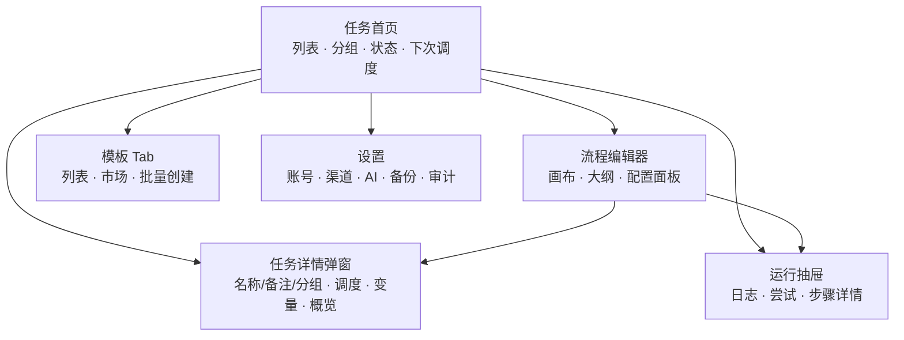
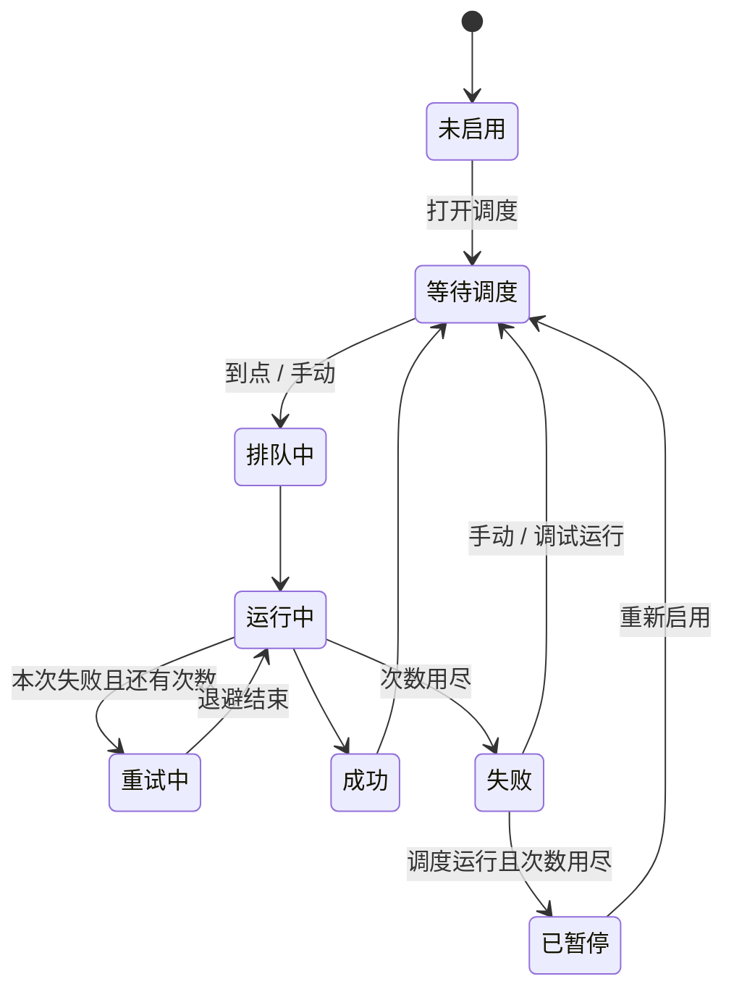
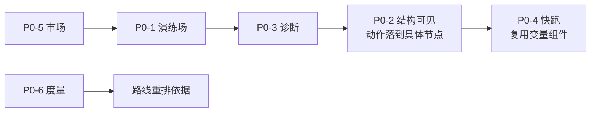
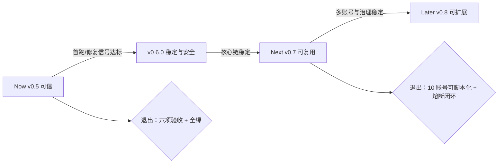

# CheckQ 产品需求文档（PRD）

> **状态**：产品基线文档（v0.6.4「可信底座补强」已交付；v0.6.5 为维护与体验版；v0.6.6 为全量重构与安全/MCP 2.0 加固版，2026-11-27 更新）
> **代码版本**：以根 / `server` / `web` 三处 `package.json` 为准（`version.js` 单源读取），本文不写死版本号。
> **本文是什么**：产品决策与需求的唯一事实源。回答"为谁做、做什么、不做什么、做到什么程度、怎么验收"。
> **本文不是什么**：不写实现细节（见 `docs/ARCHITECTURE.md`）、不写界面细节（见 `docs/UI-STANDARDS.md`）、不列全部接口（见 `docs/API.md`）。
>
> **阅读路径**
> - 只想判断方向：读 §0（一页结论）。
> - 要评审需求：读 §1、§4、§5、§8。
> - 要开发：读 §2（现状基线）、§5（需求卡）、§11（验收），再转 `ARCHITECTURE.md`。
> - 要设计/评审界面：读 §4、§6，再转 `UI-STANDARDS.md`。

---

## 0. 一页结论

### 0.1 定位

**给"会用浏览器、但不想写脚本"的人，一个把「每天点一下」变成「看得见、说得清、能复用」的定时 HTTP 自动化工作台。**

覆盖四类高频任务：签到打卡、数据查询、状态监控、批量上报。部署形态是单容器、零外部依赖、数据全在本机。

**三条承诺**（产品对外只用这三句，不堆形容词）

| 承诺 | 含义 | 今天的兑现程度 |
|---|---|---|
| 看得见 | 流程图等于真实执行：分支、循环、失败都在图上 | 已有结构分析、缺线提示与循环折叠；执行一致性仍需补核验（§2.2） |
| 说得清 | 失败要给出原因与下一步 | 已有规则诊断与动作；首页连续日志已接入诊断卡与修复入口（v0.6.3） |
| 拿得走 | 模板 = 流程 + 各自参数，可复用、可分发 | 已有跟随、派生与索引市场；仍缺模板版本与维护闭环 |

### 0.2 三个判断（本文与"功能清单式文档"的区别）

1. **最大的问题不是功能少，是"图会说谎"。**
   `foreach` 的循环体靠执行约定表达（从 `each` 走到 `next` 后继为止），画布上没有容器；更严重的是执行收尾：`failed` 出口未连线判失败，而 `true` / `false` / `next` 出口未连线会**判定为正常完成**。也就是分支漏接、条件走偏，链路静默截断，首页仍显示绿色"成功"。对以"可视化"为卖点的产品，这是信任级缺陷，优先级高于任何新能力。

2. **引擎层不弱于竞品，用户感知层弱于竞品。**
   10 种节点、双层重试、run 级 cookie 罐、模板实参分离、12 渠道、open API，能力面是够的；但 QD 有验证码识别与成规模的模板内容，青龙有多语言运行时与脚本生态。用户在选型时看到的是**内容与上手速度**，不是节点数量。

3. **没有度量，就没有可信的排序。**
   代码里没有任何漏斗事件，但 `flows` / `runs` 的时间戳已经够算"首跑时长、失败修复时长、模板复用率"。先补度量，再谈优先级打分；没有基线时用打分只会制造精度幻觉（§7、§9.1）。

### 0.3 本期（v0.5「可信」）只做六件事

| 编号 | 事项 | 用户拿到什么 | 验收信号（行为） |
|---|---|---|---|
| P0-1 | 演练场 | 零站点、零凭据，5 分钟跑通一次成功 | 新实例 8 次点击内出现一次 success 运行 |
| P0-2 | 结构可见 | 循环体、分支走向、未连线出口都能看见 | 含循环的流程可折叠看清循环体；保存时给出检查清单 |
| P0-3 | 可解释失败 | 失败有"原因 + 下一步" | 4 类高频失败都有命中规则的诊断卡 |
| P0-4 | 修改即重跑 | 改凭据后 3 次点击重跑成功 | 任务行 → 改变量 → 运行，全程不离开列表 |
| P0-5 | 模板市场 v1 | 1 分钟找到可用模板并导入 | 预览 + 哈希校验 + 变量完整性清单 |
| P0-6 | 度量最小版 | 知道首跑多久、坏多久修好、模板复用多少 | 空库为 0，有数据可手算核对 |

**建议执行顺序：P0-2 → P0-3 → P0-4 → P0-1 → P0-6 → P0-5。**
理由：先修信任（图说谎），再给留存（失败解释），再做维护效率（快跑），最后做增长（新用户与内容）。度量前置条件最少，越早落地越能验证前三项（依赖关系见 §5.7）。

### 0.4 明确不做（本期，含重估条件）

| 不做 | 为什么 | 什么条件下重估 |
|---|---|---|
| 无头浏览器 / 截图识别 | 与"单容器零依赖"冲突，镜像与内存代价高 | 浏览器类需求持续出现且可做成可选外部执行器（§9.4） |
| 验证码识别 | 同上，且涉及第三方站点合规风险 | 不做内置；只保留"外部解题节点"这种用户自担的方式 |
| Python / Shell / TS 运行时 | 会让本项目变成第二个青龙，失去简洁优势 | 不做；脚本能力只在 Node 沙箱内演进 |
| 集群 / 分布式 / 多租户 SaaS | 当前用户结构是单机自用与小团队共享 | 出现"多人多机共用一套服务"的真实诉求 |
| 内置业务模板 | 仓库只放框架（已定版，安全与合规红线） | 不重估；内容由外部索引托管（§5.5） |

### 0.5 "做对了"的样子（行为验收，不用指标承诺）

1. 新实例 5 分钟内完成一次成功运行，全程不接触真实站点与真实凭据。
2. 任何一条流程，"哪一步之后没有下一步"都能在画布上看见，并在保存时被点名。
3. 四类高频失败（凭据失效 / 断言不匹配 / 网络超时 / 缺变量）都能给出人话原因与可执行动作。
4. 失败后修好再跑，不需要离开任务列表（3 次点击内）。
5. 模板导入前能预览节点链与变量表，且篡改会被哈希拦住。
6. 空库的指标面板显示 0 而不是报错；有数据时能与手算对上。
7. `verify-round` 全绿；新增的文档校验与诊断回放全绿。
8. 文档中不存在"说的是已实现、代码里没有"的能力。

### 0.6 文档地图

| 文档 | 角色 | 权威性 |
|---|---|---|
| `docs/PRD.md`（本文） | 产品决策、需求、范围、路线、验收 | **产品决策唯一事实源** |
| `docs/ARCHITECTURE.md` | 运行时、数据模型、模块职责、扩展点、不变量 | 架构约定 |
| `docs/UI-STANDARDS.md` | 令牌、组件契约、画布语义、文案、护栏 | 界面评审（v0.5 起） |
| `docs/API.md` / `docs/MCP.md` / `docs/AGENT-ACCESS.md` | 对外接口与 Agent 接入 | 集成口径 |
| `docs/SECURITY.md` / `docs/STORAGE-BACKUP.md` | 安全模型、数据与备份 | 运维/安全 |
| `docs/COMPETITIVE-ANALYSIS.md` | 竞品**事实台账**（本文 §3 的判断依据） | 事实层，不含决策 |
| `docs/TEMPLATE-MARKET.md` | 模板索引协议 v1 | 协议规范 |
| `docs/AI-ASSIST.md` | 快速组装与 AI 助手现状/边界 | 能力说明 |
| `docs/ROADMAP.md` | v0.4 及以前的版本历史 | 历史记录 |
| `docs/QIANDAO-COMPAT.md` | QD 模板导入映射 | 兼容事实 |
| `docs/CHANGELOG.md` | 用户视角更新日志 | 发布 |

> 2026-11-15 起，`docs/PRD-v0.5.md` 为历史规划稿（结论已并入本文），不再作为事实源。

---

## 1. 产品定义

### 1.1 用户

> 以下为**基于现有功能面与竞品用户结构的产品判断**，尚无使用数据支撑（§7 会补第一批基线）。

| 用户 | 场景 | 真实痛点 | 对产品的取舍含义 |
|---|---|---|---|
| 自用型（个人） | 1–5 个站点，每天签到 / 查额度 / 看库存 | 不想写脚本；站点改版就失效；失效时看不懂日志 | 首跑与修复必须极短；错误必须说人话 |
| 共享型（家庭 / 小团队） | 10–50 个任务，多账号同一站点 | 一份流程要服务多个账号；一处改动要全员生效 | 模板 + 各自变量是核心；批量与分组是刚需 |
| 集成型（外部 Agent / 脚本） | 用 API / MCP 驱动 CheckQ | 不想维护 UI，但要能看到执行结果 | 接口稳定与日志可读优先于界面花活 |

**非目标用户**：需要浏览器渲染、验证码识别、大规模并发的采集型用户。见 §1.4。

### 1.2 四个核心任务（需求都以这四件事为锚）

| 任务 | 典型链路 | 成功的样子 |
|---|---|---|
| 签到打卡 | 登录态 cookie → 请求签到 → 断言"已签到" → 通知 | 每天到点跑，成功一条人话通知；失败说清原因 |
| 数据查询 | 请求接口 → 提取字段 → 日志/通知汇总 | 每天看到变化，异常时能被叫醒 |
| 状态监控 | 请求 → 断言阈值/关键字 → 仅在异常时通知 | 平时安静，出事才响 |
| 批量上报 | 遍历数组 → 逐项请求 → 汇总结果 | 一次跑完 N 项，失败项可定位 |

### 1.3 价值与代价（诚实版）

**用户得到**：不用写代码就能定时跑 HTTP；出错能看懂；一份流程可以服务多个账号；数据在自己机器上。

**用户要付出**：

- 需要自己拿到登录态（cookie / token），产品不代管第三方账号；
- 只覆盖 HTTP 语义，页面渲染类站点做不了；
- 单机容量有限（§2.4），不适合海量任务；
- 复杂逻辑仍要落到 `script` 节点（1 秒沙箱），它不是通用编程环境。

### 1.4 场景边界

| 能做 | 不能做 | 需要外部配合 |
|---|---|---|
| 任意 HTTP(S) 请求（方法 / 头 / body / 超时 / 重定向 / 代理 / GBK 转码） | 渲染 JS 后才能拿到的数据 | 浏览器自动化可交给外部执行器（Later） |
| 登录态复用（cookie 罐、显式 Cookie 头） | 验证码识别 | 外部解题服务 |
| JSON / 正则 / 头部 / Set-Cookie 提取 | 需要交互点击的流程 | — |
| 条件分支、遍历、变量、脚本兜底 | 大规模并发抓取（有并发与步数上限） | 多实例部署（非目标） |
| 定时（cron + 时区 + 抖动）、失败退避重试 | 高频轮询（秒级）不是设计目标，按分钟级 cron 使用 | — |
| 12 种通知渠道、站内通知、每日汇总 | 双向对话式机器人 | — |

> 对外表述统一为"定时 HTTP 自动化"，不使用"适合绝大多数挂机场景"——后者与上表冲突。

### 1.5 术语（界面与文档都用这套）

| 词 | 含义 |
|---|---|
| 任务（flow） | 一张流程图 + 调度 + 变量 + 通知配置 |
| 模板（template） | 流程图 + 默认变量，可派生多个任务 |
| 变量（vars） | 任务级键值，运行时可用 `{{name}}` 引用 |
| 步骤（node） | 流程中的一个节点（技术语境可称"节点"） |
| 运行（run） | 一次执行记录，含每次尝试与日志 |
| 调度（schedule） | cron + 时区 + 抖动 + 重试策略 |
| 通知渠道（channel） | 站内 / Webhook / 邮件等 12 种之一 |
| 凭据 | cookie、token、密码等敏感值，落盘加密、界面遮蔽 |

---

## 2. 现状基线（as-built）

> 原则：只写代码里能核对的。每条都能顺着"证据"列找到实现位置。

### 2.1 能力矩阵

| 域 | 已实现的能力 | 用户可见行为 | 证据 |
|---|---|---|---|
| 引擎 | 10 种节点（http / condition / set / extract / delay / random-delay / log / notify / script / foreach）；单链 DAG；500 步上限；断言（状态码 / 关键字 / JSON 路径）；run 级 cookie 罐；模板表达式白名单（无 eval） | 拖拽成流程，运行后每步都有请求与响应 | `server/src/model.js`、`engine.js`、`render.js`、`cookiejar.js` |
| 失败处理 | 节点级 `config.retry` + 任务级退避重试（默认开、最多 3 次、指数退避 5 秒起、单次上限 5 分钟、跑满才判失败）；调度运行跑满仍失败 → 自动停用调度并记录原因（0.5.1） | 偶发失败自动重试；日志里逐次尝试与等待时长可见；持续错误不再每拍重复刷 | `server/src/retry.js`、`auto-pause.js`、`api.js` |
| 调度 | 每任务独立 cron + 时区 + 抖动（0–30 分钟）；每 60s 对账；上次未结束则跳过这一拍；手动运行 / 调试运行 / 单步 | 列表显示下次运行时间；调试不重试 | `server/src/scheduler.js` |
| 日志 | `record` 三档（all / log / log-final）+ `level` + 关键字提取 + 连续日志流 + SSE；单次运行可导出脱敏 HAR | 默认只看人话日志；需要时逐步骤展开；可复现 | `engine.js`、`components/LogStream.jsx`、`har-export.js` |
| 通知 | 12 种渠道（站内 / Webhook / Bark / Telegram / Server酱 / PushPlus / 钉钉 / 企业微信 / 飞书 / Gotify / ntfy / 邮件 SMTP）+ 站内通知中心 + 每日汇总 | 成功/失败按配置推送，钉钉与飞书支持加签，统一 15s 超时并行发送。点击单条未读通知仅标记该条，未读数随即更新，也可全部已读。 | `server/src/notify.js`、`components/editor/modals.jsx` |
| 模板 | 模板 = 流程图 + 默认变量；派生任务读取时取模板当前图（实时跟随）；改脚本内容自动脱钩；CSV 批量创建；模板导出（脱敏） | 模板一改，所有派生任务立刻变，零操作 | `store.resolveFlow` / `sameLogic` |
| 导入导出 | HAR / cURL / QD 模板 / JSON 导入；模板从 URL 拉取；单次运行 HAR 导出；备份与恢复（默认脱敏） | 浏览器里跑一遍就能变成流程 | `har-import.js`、`curl-import.js`、`api.js` |
| 账号与安全 | 多用户与角色（admin / operator / viewer）、TOTP + 恢复码、会话可吊销、登录限流、API Key 作用域与 IP 名单、审计日志、凭据 AES-256-GCM 加密、CSP 与同源校验 | 多人共用一套实例，权限可分 | `auth.js`、`totp.js`、`secret.js` |
| 开放接口 | REST + OpenAPI 3.1 + `X-API-Key`；MCP（stdio + HTTP `/api/mcp`，22 个工具） | 外部 Agent 可创建/校验/改/跑/取消/看日志 | `api.js`、`openapi.js`、`mcp-tools.js`、`mcp/checkq-mcp.cjs` |
| 交互 | 任务表与分组折叠、任务详情、画布（调色板 / 配置面板 / 撤销 / 复制粘贴 / 整理布局 / MiniMap / 日志↔画布定位）、点选生成逻辑、一句话向导、明暗主题、窄屏四控件 | 不用写 JSON 也能改流程 | `components/FlowList.jsx`、`FlowEditor.jsx` |
| 运维 | 单容器、零原生依赖、健康检查、变更立即 flush（原子写）、低内存设备可用预构建包部署 | 一条命令起服务，升级只换镜像 | `Dockerfile`、`tools/pack-prebuilt.cjs` |
| 结构可见（v0.5） | `analyzeStructure` 统一算出口/循环/孤岛/多起点；画布空心点 + 失败角标 + 循环容器；大纲视图；保存时结构检查清单 | 断头出口、循环范围、未接入步骤一眼可见；清单只提示不改语义 | `server/src/structure.js`、`web/src/hooks/useStructure.js`、`editor/{StepNode,LoopFrame,OutlinePanel,StructureModal}.jsx` |
| 可解释失败（v0.5） | `diagnose` 九条规则（缺变量/凭据/风控/断言/网络/5xx/4xx/引擎/未知），产出 `{cause, confidence, evidence, actions}`；动作限四个白名单 | 失败第一眼是原因 + 下一步按钮，不是原始响应体 | `server/src/diagnose.js`、`components/DiagnosisCard.jsx`、`tools/diagnose-replay.cjs` |
| 演练场（v0.5） | 本机演示站点（资料/签到/列表，限速与 TTL）+ 一条演练任务；`CHECKQ_DEMO=0` 可关 | 零站点零凭据，空首页一键演练；跑通后一键换成自己的站点 | `server/src/demo.js`、`api.js` `/api/demo/*` |
| 度量（v0.5） | 本机现算：运行量/成功率、首跑中位与 p90、修复中位、模板复用、每日分布；5 个本地事件 | 设置页「统计」页签；空库显示 0；只存本机不外传 | `server/src/metrics.js`、`components/flow-list/metrics.jsx` |
| 模板市场 v1（v0.5） | 索引协议 v1（version/sha256/≤500 条/内联或 URL）；订阅、浏览、预览、哈希校验、409 覆盖或另存、敏感默认值清空 | 「市场」Tab：填索引 → 搜索标签 → 预览变量 → 导入 | `server/src/market.js`、`components/flow-list/market.jsx`、`docs/template-index.example.json` |

**规模事实**（用于判断容量与拆分，不作为卖点）：`api.js` 约 98KB / 2034 行；`FlowEditor.jsx` 722 行、`FlowList.jsx` 698 行、`RunDrawer.jsx` 326 行（画布交互已抽到 `web/src/hooks/`）；单测 44 项（2026-11-17 实测全过）。

### 2.2 五个缺口（v0.5 已逐条补上）

| 缺口 | 补法 | 状态 |
|---|---|---|
| 2.2.1 图会说谎 | 出口空心点 + 失败角标 + 循环容器 + 大纲 + 保存检查清单 | ✅ P0-2 |
| 2.2.2 失败不可解释 | 诊断卡（原因/置信/证据/动作白名单） | ✅ P0-3 |
| 2.2.3 有机制没内容 | 索引协议 v1 + 市场页 + 随包示例索引 | ✅ P0-5 |
| 2.2.4 没有度量 | 本机度量 + 5 个本地事件（不外传） | ✅ P0-6 |
| 2.2.5 规模反噬 | 循环容器默认收敛 + 大纲视图 + hooks 拆分 | ◐ 折叠开关未做（大纲已足够应对数十节点） |

下面是缺口当时的原始描述，保留作为判断依据。

#### 2.2.1 图会说谎（最高优先级）

- 分支节点有 `true` / `false` 两个出口，`foreach` 有 `each` / `next`，但画布只画节点与连线，**没有"这里有出口没接线"的视觉提示**。
- 执行收尾的语义不对称：`failed` 未接判失败；其余出口未接**判成功**。于是"漏接一条线"会表现为"跑成功了但没做事"，这比直接报错更难排查。
- `foreach` 的循环体是执行约定（走到 `next` 后继即止），画布没有容器，用户无法判断"循环到哪结束"。
- 结论：可视化产品的第一承诺（看得见）目前只做到"节点可见"，未做到"结构可见"。

#### 2.2.2 失败不可解释

- 现有失败信息是：错误分类（全部 / 网络 / 断言 / 引擎）、每步请求与响应、断言结果。
- 缺的是：**为什么失败、下一步做什么**。同类问题（凭据过期、风控跳登录页、断言写错字段、变量没定义）都要用户自己从响应体里推断。
- 竞品同样只有原始日志或 stdout —— 这是投入产出比最高、最容易形成差异的一格。

#### 2.2.3 有机制、没内容

- 模板的"实参分离 + 自动跟随"已经成立，也能从 URL 拉取索引，但分发端只有一个裸输入框：没有目录、预览、哈希、版本、订阅。
- 结果是：机制很好，但用户找不到模板；新用户仍然要自带站点与凭据才能产生第一次成功运行。

#### 2.2.4 没有度量

- 代码里没有任何漏斗事件。无法回答：新用户多久跑通第一次？失败后多久修好？模板被复用了几次？
- `flows.createdAt` 与 `runs` 时间戳已足够算这三件事，不需要新增采集。

#### 2.2.5 规模反噬

- 仓库里已有数十节点、接近 100KB 的真实流程样例（仅本地、不入库）。画布到这个量级，"可视化"退化成"一大片框"。
- 若不提供结构折叠与大纲视图，重度用户会回到脚本——那正好是青龙的主场。

### 2.3 一致性治理（防止文档再次跑偏）

产品文档的失效通常不是写错，而是"没人负责对齐"。本文采用三条纪律：

1. **能力必须可核对**：§2.1 每行都给代码路径；新增能力必须同时补这一行与验收项。
2. **状态必须机械校验**：版本号以三处 `package.json` 为准；UI 契约由 `copy-audit` / `ui-smoke` / `project-audit` 拦；接口与 MCP 工具由 `docs/API.md`、`docs/MCP.md` 与代码对照。
3. **单一事实源**：产品决策只在本文；架构只在 `ARCHITECTURE.md`；界面只在 `UI-STANDARDS.md`。旧稿只保留历史价值，不再更新。

> 2026-11-15 已按此纪律修掉 6 处"文档说未实现、代码已实现"与"文档说已实现、代码没有"的不一致（README 步骤清单、节点状态、覆盖矩阵、备份状态、版本口径、竞品快照）。

### 2.4 技术约束与产品含义

| 约束 | 产品含义 | 应对 |
|---|---|---|
| 单容器、零外部依赖 | 不能引入浏览器、数据库、多语言运行时 | 把它写进对外定位，主动放弃相应场景 |
| 数据是 JSON 文件、全量读写 | 任务与运行记录到一定量级会变慢 | 先补度量与容量阈值，再考虑归档/分片（§9.3 触发器） |
| 单链执行、500 步上限、`foreach` 50 轮 | 不适合海量并发与深度嵌套 | 用"轻量自动化"定位，不做采集器 |
| 脚本是 1 秒 Node 沙箱（无网络 / 无 fs） | 只能做纯计算与数据拼装 | 明确为"逃生舱"，不作为常规路径 |
| 同任务串行队列 + 全局并发上限 | 同一任务不会并发打架；跨任务默认最多同时 4 个 | 排队状态必须可见（避免"点了没反应"） |

---

## 3. 竞品：QD 与青龙

> 事实与来源见 `docs/COMPETITIVE-ANALYSIS.md`（2026-11-15 抓取公开仓库）；本节只保留会改变决策的部分。

### 3.1 两个对手强在哪

**QD（qiandao）**

- 自述是"HTTP 请求定时任务自动执行框架"，核心资产是**模板 + 请求列表**：用户从模板库挑选，填自己的 cookie 即可用。
- 提供多套镜像（含验证码识别、TLS 指纹等能力），把"站点反爬"当作产品能力来打。
- 明确声明维护精力有限、仅保证对某一浏览器的支持——这说明它的强项在内容与协议深度，弱项在长期体验。

**青龙（qinglong）**

- 自述是"支持多语言的定时任务管理平台"：脚本、环境变量、依赖、订阅仓库、日志、通知一应俱全。
- 强在**脚本生态与自动化编排**（订阅、依赖安装、OpenAPI、CLI、Agent Skill），适合"会写脚本的人"。
- 代价是部署与心智成本：多运行时、依赖管理、非 root 运行的额外约束。

### 3.2 六维对照

| 维度 | CheckQ | QD | 青龙 |
|---|---|---|---|
| 目标用户 | 不想写脚本的个人与小团队 | 会用模板的签到用户 | 会写脚本的进阶用户 |
| 核心路径 | 画布搭流程 → 定时跑 → 看日志 | 选模板 → 填参数 → 跑 | 写/装脚本 → 配环境变量 → 跑 |
| 价值 | 可视化 + 可解释 + 零依赖 | 内容多 + 协议深 | 自由度高 + 生态强 |
| 代价 | 只覆盖 HTTP；内容少 | 体验与长期维护弱 | 部署与学习成本高 |
| 能力边界 | 不做浏览器与验证码 | 强在反爬，弱在多步编排体验 | 强在脚本，弱在可视化 |
| 交付形态 | 单容器 | 容器 + 多镜像 | 容器 + 多运行时 |

### 3.3 能力对照

| 能力 | CheckQ | QD | 青龙 | 对我们的含义 |
|---|---|---|---|---|
| 可视化流程编辑 | ✅ 画布 + 点选 | 请求列表（模板驱动） | ❌（脚本） | 我们的主战场 |
| 模板与内容分发 | 机制 ✅ / 分发 ❌ | ✅ 模板库 | 订阅脚本仓库 | 必须补分发（P0-5） |
| 多语言脚本 | Node 沙箱（受限） | ❌ | ✅ | 不跟，保持简洁 |
| 验证码 / 浏览器 | ❌ | ✅（镜像） | 靠脚本 | 不跟，写进边界 |
| 通知渠道 | 12 种 | 常见几种 | 多 | 已追平 |
| 多用户与权限 | ✅ 三角色 | 弱 | ✅ | 已追平 |
| 开放接口 | REST + OpenAPI + MCP | API | OpenAPI + CLI | 已追平并有 MCP 差异 |
| 失败可解释 | ❌（本期补） | ❌ | ❌ | **最大差异点** |
| 首次成功路径 | ❌（本期补） | 模板即上手 | 需写脚本 | **第二差异点** |
| 部署复杂度 | 单容器 | 单容器多镜像 | 多运行时 | 我们的结构性优势 |
| 数据主权 | 全本机 JSON | 本机 | 本机 | 持平 |

### 3.4 取：六条要采纳，但要改造后采纳

| # | 取自 | 做法 | 为什么改造 |
|---|---|---|---|
| 1 | QD 模板库 | 做**索引协议 + 客户端**，内容外部托管；导入前预览 + 哈希 + 变量清单 | 内置内容有合规与维护风险（已定版） |
| 2 | QD 请求列表 | 做成与画布并列的**大纲视图**（可键盘操作），不做替代 | 画布是差异点，但大流程需要列表密度 |
| 3 | 青龙订阅 | 订阅**索引**而非脚本；有更新只提示，不自动覆盖 | 自动覆盖会破坏用户已改的流程 |
| 4 | 青龙 CLI/Agent | 先用已有 MCP 承担；CLI 只在有真实诉求时做薄壳 | 避免维护第二套接口 |
| 5 | QD 镜像分层 | 不做内置，但把"协议深度"做成可选扩展点（外部执行器） | 镜像会毁掉单容器优势 |
| 6 | 青龙通知 | 已追平；下一步做"主渠道失败转备用"与"通知失败可见" | 通知是自动化闭环的最后一公里 |

### 3.5 舍：五条不采纳

| 不做 | 理由 |
|---|---|
| 内置浏览器 / 截图识别 | 单容器优势与维护成本；且不是我们的用户主要诉求 |
| 内置验证码识别 | 合规风险高、模型与算力代价大 |
| Python / Shell / TS 运行时 | 会把产品变成"第二个青龙"，丢掉简洁定位 |
| 集群与多租户 | 没有真实诉求；会让数据模型与权限复杂度翻倍 |
| 内置业务模板库 | 仓库只放框架（安全与内容政策） |

### 3.6 结论：争什么、不争什么

- **争**：首跑时间、故障修复时间、流程可读性。
- **不争**：内容总量、协议深度、脚本自由度。
- 一句话：**别人比谁更能"跑通奇怪的站点"，我们比谁更能"让普通人第一次就跑通、坏了能自己修好"。**

---

## 4. 用户操作逻辑

### 4.1 信息架构



**一屏一件事**：首页回答"我的任务现在怎么样"，编辑器回答"这条流程怎么走"，抽屉回答"刚才为什么失败"。

### 4.2 入口归属（一个动作只有一个家）

| 动作 | 唯一入口 | 不允许出现在 |
|---|---|---|
| 看/改名称、备注、分组、调度、变量 | 点任务名 → 任务详情 | 任务行「⋯」菜单（已移除） |
| 编辑流程图 | 任务行「⋯ → 编辑流程」 | 点任务名（避免误入画布） |
| 看日志 | 任务行「日志」/ 状态徽章 / 运行结束提示 | 详情弹窗（详情只给摘要与跳转） |
| 新建任务 | 顶栏「+」→ 四个分支（§4.5） | 「更多」菜单（v0.5 迁移） |
| 存为模板 | 编辑器「更多 → 存为模板」 | 首页（模板是编辑后的动作） |
| 模板市场 | 模板 Tab | 编辑器内部 |
| 备份 / 账号 / 渠道 / AI | 设置 | 任务页 |

### 4.3 四条旅程

**J1 首次上手（新实例，零数据）**

| 步 | 用户做什么 | 看到什么 | 失败去向 |
|---|---|---|---|
| 1 | 打开首页 | 空状态："还没有任务。先演练一遍，30 秒看到一次成功运行。" | — |
| 2 | 点「先演练一遍」 | 内置演练模板（只指向内置 demo 端点） | 无网络时提示"演练需要访问本机 demo 端点" |
| 3 | 点运行 | 逐步骤日志，最后一条人话"演练成功" | 失败 → 诊断卡给出原因 |
| 4 | 点响应里的字段 | 生成一个"提取"节点（可撤销） | 生成失败保留原位并提示 |
| 5 | 设一个通知渠道 | 站内通知到达 | 渠道测试失败给出错误原因 |
| 6 | 设调度 | 列表出现"下次运行" | cron 非法就地提示 |

点击预算：≤8 次；不接触真实站点、真实凭据。

**J2 新建一条自己的任务**

| 入口 | 前置 | 结果 |
|---|---|---|
| 空流程 | 知道自己要请求什么 | 画布带「HTTP → 日志」两节点骨架 |
| 从模板 | 模板 Tab 有可用模板 | 预填结构，只填变量 |
| 导入 HAR | 浏览器里跑过一次目标请求 | 自动生成多步链 |
| 导入 cURL | 从文档/终端复制到命令 | 生成单个 http 节点 |
| 一句话向导 | 只有一个 URL 与成功词 | 规则生成 2 节点（不耗 API） |

**J3 排障（最常见，也最影响留存）**

现状路径：任务行「日志」→ 抽屉 → 切「全部」→ 找失败步 → 看响应 → 自己推断。
目标路径（P0-3/P0-4）：任务行看到"失败"→ 打开抽屉看到诊断卡（原因 + 证据 + 下一步）→ 点动作（改凭据 / 看该步响应 / 调整断言）→ 运行 → 成功。全程 3–5 次点击，不离开列表。

**J4 复用与分发**

模板一改，派生任务立刻跟随（已实现）；模板保存/导出/批量创建（已实现）；发现与导入外部模板（P0-5 补）。

### 4.4 状态与语言

**状态词表（界面不得自造同义词）**



**连续失败自动停用（0.5.1）**：调度触发的运行在重试全部用尽仍失败时，任务自动停用调度并记录原因（列表显示「已暂停」，任务详情给出恢复开关）。手动与调试运行失败不动调度；成功运行不清标记。目的是避免同一个错误在每拍重复刷。

**每日汇总口径（0.5.3）**：每日汇总已独立成**系统通知**，不再借用任何任务的通知渠道。系统渠道存 `channels.json`（与任务凭据同套加密策略），内置站内通知且不可移除，外部渠道最多 10 条；实例级开关、发送时间、时区与空日策略都在设置页维护。标题与来源恒为「每日汇总」，任务停用或删除不影响汇总；旧「推送单位」自动迁移一次，`targetFlowIds` 只读保留一版。

**失败呈现三件套**：状态点 + 一句话原因 + 一个入口（看该步响应 / 改变量 / 调断言 / 重跑）。只有状态点不算合格。

**时间与数字**：绝对时间"今天 08:30 / 11-14 08:30"，相对时间只用于"3 分钟前"；统计必须写口径（如"近 7 天 · 本机时间"）。

### 4.5 创建入口：从单按钮到四分支

现状（v0.5 已改）：主按钮「+ 新建」是一个下拉，四个并列选项——**空白流程 / 从模板 / 导入 HAR·JSON / 导入 cURL**；「从模板」直接切到模板页签；「更多」只留进阶动作（快速组装、主题、通知、文档、退出）。理由：这四种的真实前置条件不同（有浏览器现场 / 有模板 / 什么都没有），并列比嵌套更省一次判断。

---

## 5. 本期需求（P0 六张卡）

> 每张卡按 `问题依据 → 目标结果 → 改动 → 行为 → 异常与边界 → 验收` 展开。全部在现有架构内完成，不引入新运行时依赖。
>
> **交付状态（2026-11-16）**：六张卡全部交付并通过验收（单测 35 文件、构建、三审计、`diagnose-replay` 7 条 fixture）。每张卡末尾的「交付位置」写的是落地实现，便于逐条核对。

### 5.1 P0-1 演练场（Sandbox）

**问题依据**：§2.2.3。仓库政策不内置业务模板，空实例首页只有空表与一个按钮；QD 用模板内容解决，青龙用 hello world 脚本解决，我们两者都没有。

**目标结果**：零真实站点、零凭据，5 分钟内走完"运行成功 → 点选 → 加通知 → 设调度"，并理解流程 / 变量 / 调度三个概念。

**改动**
- 服务端三个内置端点：`POST /api/demo/checkin`（返回成功 JSON / 需登录 / 风控 403 三态可配）、`GET /api/demo/items`（分页数组，喂 `foreach`）、`GET /api/demo/profile`（下发 Set-Cookie）；数据只在内存、1 小时后丢弃、按 IP 限速；`CHECKQ_DEMO=0` 可整体关闭。
- 一条内置演练模板，节点只指向上述端点，不含任何第三方站点信息，不进模板市场。
- 前端：空首页增加「先演练一遍」；演练期间显示"演示数据"标记；完成引导后提供「换成我自己的站点」（清空变量、保留结构）。

**行为**：点击 → 创建演练任务（默认停用）→ 运行 → 成功 → 点选字段生成节点 → 渠道测试 → 设调度 → 列表可见下次运行。

**异常与边界**：demo 关闭时入口隐藏并说明原因；重复点击复用同一演练任务；演练任务不参与市场导出。

**验收**：新实例 8 次点击内出现 success 运行；全程不出现任何真实站点域名；关闭 `CHECKQ_DEMO` 后入口消失且无报错。

### 5.2 P0-2 结构可见

**问题依据**：§2.2.1。`foreach` 循环体靠执行约定；分支未连线静默通过；已有数十节点样例。

**目标结果**：任何一条流程，"哪一步之后没有下一步""循环从哪到哪"都能在画布上看见；保存时被点名；但**不阻止保存**。

**改动**
- 服务端：`validateFlow` 产出结构化检查结果（缺线出口、孤立节点、循环体范围、无起点/多起点），随 `GET /api/flows/:id` 或独立端点返回；**不改执行语义**。
- 画布：出口标注（http 成功/失败、condition 真/假、foreach 每项/结束）、未连线出口空心圆点 + 悬停提示、失败边虚线 + 节点角标、循环体虚线容器（纯渲染分组，不改 `nodes/edges`）。
- 大纲视图：与画布并列的列表视图，按层级缩进，键盘可完成建流程。
- 保存时弹「结构检查清单」（仅提示，可忽略并继续保存）。

**行为**：拖一个 condition 只接真分支 → 假出口出现圆点；保存 → 清单写"分支「假」没有下一步"；点清单项 → 画布定位该节点。

**异常与边界**：容器折叠只影响渲染，不影响坐标与导出；大纲视图与画布选择状态双向同步；≥60 节点默认折叠循环体。

**验收**：含循环流程可折叠看清循环体；存在未连线出口时保存出现清单且能保存成功；导出 JSON 与修复前结构一致（不含渲染字段）。

### 5.3 P0-3 可解释失败（诊断）

**问题依据**：§2.2.2。只有错误分类与原始响应。

**目标结果**：四类高频失败各有"原因 + 证据 + 下一步"，且动作可执行、可撤销。

**改动**
- 新增纯函数 `diagnose.js`（输入 `stepLog + flow`，输出 `{cause, confidence, evidence[], actions[]}`），不依赖 store、不调模型。
- 首批规则：凭据失效（跳登录页 / 401 / 关键字命中登录）、断言不匹配（实际值 vs 期望值并列）、网络层（超时 / DNS / TLS / 4xx-5xx 区分）、缺变量（渲染时未定义）、被风控（403 + 挑战特征）。
- 前端：运行抽屉顶部诊断卡（原因一句话、证据可展开、动作按钮）；动作白名单：跳到该步响应、改变量、打开断言编辑、复制为 issue 摘要。

**行为**：失败运行 → 抽屉顶部出现诊断卡 → 点「改变量」→ 面板内改凭据 → 保存并运行。

**异常与边界**：规则不命中时输出"暂时无法判断原因，建议看第 N 步响应"，不给动作按钮；低置信只提示不给按钮；诊断不自动改流程、不自动重跑。

**验收**：4 类 fixture 均命中；篡改 fixture 不回退其它规则；`diagnose-replay` 全绿；诊断卡不出现"可能""也许"这类无法验证的措辞。

### 5.4 P0-4 修改即重跑

**问题依据**：§2.2.2 的延伸。修凭据要进详情/弹窗/画布三层。

**目标结果**：失败任务在列表内 3 次点击完成"改凭据 → 重跑成功"。

**改动**：任务行主操作改为 `运行 ▾`，菜单项：运行 / 带改变量运行 / 只看日志 / 调试运行；「带改变量运行」打开轻面板（只列变量，敏感项遮蔽），底部「保存并运行」。

**行为**：失败行 → `运行 ▾` → 带改变量运行 → 改变量 → 保存并运行 → 成功。

**异常与边界**：运行中再次触发 → 排队提示，不重复运行；改完未运行 → 提示"已保存，未运行"并可一键运行；viewer 角色不出现写入口。

**验收**：3 次点击完成；并发点击只产生 1 次运行；取消后原值不变。

### 5.5 P0-5 模板市场 v1

**问题依据**：§2.2.3。机制成立、分发缺位。

**目标结果**：1 分钟内找到并导入一个可用模板；导入前知道它要什么变量、会做几步。

**改动**
- 索引协议 v1（详见 `docs/TEMPLATE-MARKET.md`）：`{ version, entries: [{ id, name, desc, tags[], vars[], nodes, edges, sha256, minApp, updatedAt, source }] }`。
- 市场页（模板 Tab 内）：搜索 / 标签筛选 / 卡片（步数、变量数、是否需凭据、更新时间）/ 详情预览（节点链 + 变量表 + 首次运行提示）。
- 导入：sha256 校验 → 敏感默认值强制清空 → 任务默认停用 → 变量完整性清单（缺必填标红但不阻止保存）。
- 订阅：可填索引 URL「关注」，有新条目只提示，不自动导入或覆盖。
- 治理：内容外部托管；框架只内置协议与客户端；每个条目展示来源与哈希。

**异常与边界**：哈希不符 / 字段缺失 → 拒绝并点名具体字段；索引 >1MB 或非 http(s) → 拒绝；同 id 重复导入 → 选择覆盖或另存。

**验收**：粘贴索引 URL → 列表出现条目 → 预览 → 导入 → 填变量 → 用 demo 端点跑通；篡改条目被哈希拦下；仓库与内置内容无第三方站点与凭据。

### 5.6 P0-6 度量最小版

**问题依据**：§2.2.4。

**目标结果**：能回答三个问题——首跑成功要多久、失败多久修好、模板复用多少。

**改动**
- 服务端派生指标 `GET /api/system/metrics?range=`（不新增敏感数据，全部由 `flows` / `runs` 时间戳计算）：
  - `firstSuccessMs`：`createdAt` → 该任务首次 success 运行；
  - `repairMedianMs`：失败运行 → 同任务下一次 success；
  - `templateFanout`：派生任务数 / 模板数；
  - `runSuccessRate`：按任务、按天。
- 前端本地事件（写 `meta`，不外传）：`wizard_open` / `pick_apply` / `diag_action` / `guide_step`。
- 设置页「统计」小面板；**不做遥测上报**，界面也不出现"匿名统计"开关。

**异常与边界**：空库返回 0 不报错；runs 达到保留上限时按实际保留计算并在界面标注口径；时区变化仍按服务器本地日期。

**验收**：空库数值为 0；跑 2 个任务后与手算一致（含跨天边界）；关闭再打开面板数值稳定。

### 5.7 依赖与排布



- 顺序：**P0-2 → P0-3 → P0-4 → P0-1 → P0-6 → P0-5**。
- 拆分原则：P0-2 与 P0-3 都不应做成大重构；`diagnose.js` 独立纯函数、画布容器只加渲染层，保证可回滚。

### 5.8 交付对照（2026-11-16）

| 卡 | 服务端 | 前端 | 护栏 |
|---|---|---|---|
| P0-1 演练场 | `demo.js`、`/api/demo/*`、`/api/system/features`、`store.createFlow` 支持 `isDemo` | 空首页「先演练一遍」、编辑器「演示 · 换成我的站点」 | `v05.test.js`（演示端到端，含 401 失败与复用同一任务） |
| P0-2 结构可见 | `structure.js`、`GET /api/flows/:id` 带 `structure` | `useStructure`、`StepNode` 出口标注、`LoopFrame`（含 ≥60 节点默认折叠）、`OutlinePanel`、`StructureModal`、保存检查清单 | `structure.test.js` 28 项 |
| P0-3 可解释失败 | `diagnose.js` 九条规则、run 上带 `diagnosis` | `DiagnosisCard` + 四个白名单动作接到运行抽屉 | `diagnose.test.js` 42 项、`tools/diagnose-replay.cjs` 7 条 fixture |
| P0-4 修改即重跑 | `run` 支持 `dedupe:true`、`manualInFlight` 去重 | 任务行「运行 ▾」（运行 / 带改变量运行 / 只看日志 / 调试运行）、`vars-quick.jsx` | `v05.test.js`（并发点击去重） |
| P0-5 模板市场 v1 | `market.js`、`/api/market/*`、`store` 模板带 `market` 元数据 | 「市场」Tab：订阅 / 搜索 / 标签 / 预览 / 409 覆盖或另存 | `v05.test.js`（离线校验、哈希不符拒绝）、`example-index.test.js` |
| P0-6 度量最小版 | `metrics.js`、`/api/system/metrics`、`/api/system/events` | 设置页「统计」页签、5 个本地事件埋点 | `v05.test.js`（数值可手算、备份不含本地事件） |

---

## 6. 交互与界面标准（摘要）

> 完整标准（令牌、组件契约、画布语义细则、文案模板、响应式、可访问性、性能预算、自查清单）见 `docs/UI-STANDARDS.md`。两处冲突以 `UI-STANDARDS.md` 为准。

**12 条交互契约（新增页面必须全满足）**

1. 一页一主任务，说明性文字不常驻。
2. 默认值先给，不填也能跑。
3. 渐进披露三层：可见 → 展开 → 弹窗。
4. 保存语义分明：画布自动保存（顶栏"未保存"点）；表单显式保存（主按钮最右）。
5. 危险操作二次确认，写明对象与影响。
6. 错误三段式：`{对象}{动作}失败：{原因}。{下一步}`。
7. 空状态必须有一个动作。
8. 加载分级：>300ms 骨架屏，>2s 进度文字。
9. 尊重取消：跳过引导后不再强推。
10. 键盘完整：Esc / Enter / Tab / Ctrl+S / Ctrl+Z / Ctrl+Y。
11. 图标与文案：不用 emoji 当图标；按钮 = 动词 + 对象；状态 = 圆点 + 文字。
12. 数字与时间：等宽数字，时间口径明确。

**画布语义要点**：出口标注、未连线空心圆点、失败边虚线、循环体虚线容器（不改数据）、≥60 节点默认折叠、日志↔画布双向定位。

**移动端定位**：只读 + 三动作（运行 / 看日志 / 改变量），不做画布编辑。

---

## 7. 数据与度量

### 7.1 口径

| 指标 | 定义 | 数据来源 | 说明 |
|---|---|---|---|
| 首跑时长 | 任务创建 → 首次成功运行 | `flows.createdAt`、`runs` | 按任务算，取中位数与 P90 |
| 修复时长 | 失败运行 → 同任务下一次成功 | `runs` | 只统计"失败后确实再次运行"的样本 |
| 模板复用率 | 派生任务数 / 模板数 | `flows.tplId`、`templates` | 空模板不计入分母 |
| 运行成功率 | 成功 / 总运行 | `runs` | 分任务、分天；含重试后的最终结论 |

### 7.2 采集与隐私

- 全部聚合在本机计算，**不外传**；不引入第三方统计 SDK。
- 前端行为事件只写本地 `meta`，用于产品自查，不随备份默认导出。
- 任何日志、导出、备份都必须脱敏（已有机制，新增字段同样适用）。

### 7.3 基线与目标

1. 先跑满两周基线（不设目标值，只记录分布）。
2. 基线稳定后，再按"首跑 P90 ≤ 5 分钟""修复中位数 ≤ 10 分钟"这类**可由行为验证**的阈值设目标，并在本文记录设定理由与校准方式。
3. 目标一旦不达标，允许调整产品方案，不允许改口径。

### 7.4 不做的度量

- 不做用户级行为追踪、不做 A/B 分流、不做"使用时长"这类无行动指向的指标。

---

## 8. 范围与非目标

### 8.1 本轮取舍

| 类别 | 内容 |
|---|---|
| **保留（不动）** | 模板自动跟随、入口归属、原生 dialog/Popover、任务级重试默认开启、窄屏四控件、仓库只放框架、日志唯一证据入口 |
| **新增** | 演练场、结构可见（容器/标注/清单/大纲）、诊断卡与动作、快跑面板、模板市场与索引协议、度量面板、`diagnose-replay` 护栏 |
| **修改** | 「+ 新建任务」改为四分支；任务表窄屏信息优先级；README 步骤表；版本口径 |
| **移除** | 模板 Tab 里的裸 URL 输入框（并入市场页）；「更多」里的创建类动作（挪到新建分支） |
| **暂不做** | 无头浏览器、验证码识别、多语言运行时、集群、SaaS 多租户、移动端画布编辑 |

### 8.2 后续候选

| 项 | 解决什么 | 阶段 | 前置 |
|---|---|---|---|
| 账号 / 凭据中心 | 一模板 N 账号、账号级成功率、凭据轮换提醒 | v0.7 | 凭据加密（已有）+ 批量创建（已有） |
| 运行治理 | 并发上限、取消、流级超时、重启中断与连续失败熔断 | 并发上限 v0.6.0、取消与超时 v0.6.4 已发布；重启中断见 §9.2.5；熔断为 v0.7 候选 | 状态词表 + 调度器 |
| 通知升级 | 飞书/钉钉卡片、主渠道失败转备用、通知失败可见 | 失败可见 v0.6.0 已交付；卡片/降级 v0.7 | 12 渠道（已有） |
| 凭据加密补全 | AI 助手 API Key 与其余敏感配置纳入同一加密策略 | v0.6.0 已交付 | 现有 `secret.js` |
| 每日汇总独立成系统通知 | 汇总不再借任务渠道：独立渠道集合、实例级开关、标题与来源不挂任务；需求见 `docs/REQ-DAILY-SUMMARY.md` | v0.5.3（缺陷修复） | 已实施并通过 AC-1～AC-12 |
| 流程版本 | 快照 + 回滚 + 差异 | Later | 画布语义稳定 |
| 移动端结果页 | 手机看结果 + 一键重跑 | Later | 响应式改造完成 |
| CLI | 终端与 Agent 编排 | Later | MCP（已有） |
| 可选指纹镜像 | 应对 TLS 指纹类风控 | Later | 出现真实用户被拦的案例 |

---

## 9. 发展路线

### 9.1 排序问题与原则

**要优化的结果**：让"第一次成功"和"坏了能修好"发生得更快；其次才是复用与生态。

**硬约束（先于评分）**

1. 安全与脱敏不得回退。
2. 单容器零依赖不破。
3. 改动可回滚（不引入数据迁移型重构）。
4. 已定版交互不回退。

**排序原则**：`硬约束 > 留存路径（首跑/修复）> 复用（模板/账号）> 生态（市场/CLI）> 扩展（执行器）`。

**为什么不用 RICE**：没有 reach/impact 的可靠输入。等 §7 跑满两周基线再引入评分；在此之前只做"约束优先 + 依赖顺序"。

### 9.2 已交付 —— v0.5「可信」

| 字段 | 内容 |
|---|---|
| 目标结果 | 新实例 5 分钟首跑成功；四类失败 1 分钟定位；图不再说谎 |
| 当前问题 | 空实例无起点；失败只给原始日志；循环体与缺线不可见 |
| 关键行动 | P0-2 / P0-3 / P0-4 / P0-1 / P0-6 / P0-5，按 §5.7 顺序 |
| 依赖与容量 | 无新依赖；前端改动集中在三个入口（721 / 301 / 637 行），建议先抽 `hooks/` |
| 结果信号 | 首跑成功率（基线后定阈值）、诊断动作点击率、结构检查清单触发后修正率 |
| 退出条件 | 六项均通过 §11.1；`verify-round` 全绿；README/PRD 与实现一致；可发版 |
| 重排触发器 | 首跑成功率低于基线（基线后判定）→ 暂停 P0-5，全力修 onboarding |

### 9.2.1 已交付 —— v0.6.0「稳定与安全」

| 字段 | 内容 |
|---|---|
| 目标结果 | 核心执行链可长期稳定运行；凭据不再有明文欠账；通知失败不静默 |
| 交付内容 | meta AI Key / 旧 API Key 加密补全；12 渠道统一出口（超时 + 并行）；`run.notify` 与站内告警；全局并发上限（默认 4，`CHECKQ_MAX_CONCURRENCY` 可调） |
| 明确不做 | 账号中心、运行取消、流级超时、熔断、通知卡片、市场分页 |
| 结果信号 | 全量单测 44/44；`verify-round` 全绿；生产升级后健康接口与旧任务不变 |
| 退出条件 | 文档/版本/验收/生产升级全部完成（见 `docs/REQ-V06-STABILITY.md`） |

### 9.2.2 已交付 —— v0.6.1「自动恢复探测」

| 字段 | 内容 |
|---|---|
| 目标结果 | 站点临时恢复后，任务能按用户许可回来；默认不探测，避免失败账号反复触发风控 |
| 交付内容 | 任务级 `recovery` 配置（默认关闭，30–1440 分钟、最多 5 次）；自动停用后按间隔静默探测；成功自动启用、失败到上限停止并写站内通知；两处调度 UI 共用控件；暂停状态与探测记录可见 |
| 明确不做 | 手动“探测一次”按钮、跨任务共享探测策略、指数退避探测、账号中心 |

### 9.2.3 已交付 —— v0.6.2「品牌与登录体验」

| 字段 | 内容 |
|---|---|
| 目标结果 | 品牌在标签页、登录页、工作台与 GitHub 文档中保持一致、可识别；第一次打开就能看懂产品在做什么 |
| 交付内容 | 正式标志（深青徽章 + 白勾 + Q 尾点）与 SVG/ICO/PNG/apple-touch-icon；`Logo.jsx` 共用组件；登录页品牌区 + 表单卡双列（≤820px 单列）；加载态与空状态品牌化；`docs/BRAND.md`、README、GitHub Pages、社交预览同步 |
| 明确不做 | 品牌周边、完整 VI 手册、营销站、逐页插画 |

### 9.2.4 已交付 —— v0.6.3「可信底座补强」

| 字段 | 内容 |
|---|---|
| 目标结果 | 日常使用时，日志与备份不再泄露凭据；首页能看到任务在跑，失败能在日志里直接拿到原因与修复入口 |
| 交付内容 | `redact.js` 统一日志/导出脱敏（URL、headers、Cookie、body、动态值）；默认备份节点级脱敏；可信代理与客户端 IP；首页 30 秒静默刷新与运行/排队状态；连续日志诊断卡；`http` 失败出口真正接管失败分支；Cookie 罐支持 Path/Secure/Expires 与域后缀校验；日志按整次运行分页；审查 F01–F23 回归修复 |
| 明确不做 | `script` 独立进程隔离（T01）、read Key 任务范围与凭据隔离（T05）、运行取消/流级超时/持久化在途（T12） |
| 结果信号 | 新日志/备份测试通过；全量 `verify-round` 全绿；生产升级后既有任务照常运行 |
| 退出条件 | 文档/版本/验收/生产升级全部完成 |

### 9.2.5 当前维护迭代 —— 运行历史可信、安全与 Agent 双模加固

| 方向 | 用户结果与验收 |
|---|---|
| 稳定性 | 服务重启后，遗留的排队和执行记录结束为「已中断」，已结束记录原样保留。历史对账只更新历史，不重放请求、不改变任务调度、不发送通知。凭据或风控原因导致的自动停用跳过恢复探测，避免加重封禁。 |
| 安全性 | `Store` 按文件分域 flush 与批处理，API Key 最近使用节流持久化；损坏或密钥不匹配的 `enc:v1:` 密文中止启动拒绝覆写；仅信任显式/受控代理跳点（`127.0.0.0/8` / `::1` / `172.16.0.0/12`），支持十六进制 v4-mapped IPv6；强制 HTTP(S) 协议白名单、TOTP 登录步防重放与 SMTP 防注入。 |
| Agent 与 AI | `PATCH /api/flows/:id/vars` 支持免 `secrets` 作用域安全合并变量；`POST /api/flows/validate` 静态校验草稿；`POST /api/flows/:id/run` 支持 `wait:false` 异步；MCP 升级到 22 工具并暴露 `POST /api/mcp` Streamable HTTP；内置 AI 支持 `<think>` 清洗、长度截断重试与回包凭据拦截。 |
| 性能与前端 | 事件驱动 Toast、画布节点 memo 化、按需加载 xyflow CSS、`Ctrl+S`/离开未保存拦截、`VarsQuickModal` 全量加载、`CsvImportModal` 数组计数修复、CSS token 清理。 |

后续优先验证高历史量下的磁盘写入量、任务列表与日志接口延迟，以及桌面和窄屏的「首次运行 → 查看失败 → 修正并重跑」路径。若日志增长已影响调度或查看，再评估运行归档分区改造。

### 9.3 Next —— v0.7「可复用」

| 字段 | 内容 |
|---|---|
| 目标结果 | 一个模板稳定服务多账号；坏掉的任务不会静默跑一整夜 |
| 当前问题 | 多账号仍依赖 CSV 等批量输入。连续失败治理已有自动停用与可选探测，冷却策略待评审。模板市场已有索引订阅，更新提示仍缺。通知失败已可见，备用渠道降级待补。 |
| 关键行动 | 评审连续失败治理、通知降级、模板版本提示与账号凭据中心，按 §9.1 和 §9.2.5 的验收结果排期。 |
| 依赖 | 凭据加密、批量创建、调度器与队列语义 |
| 结果信号 | 模板派生任务数增长；熔断后 24h 内恢复率；通知失败可见率 |
| 退出条件 | 10 账号场景不经手拼 CSV 可完成；熔断与恢复可追溯；无新增运行时 |
| 重排触发器 | 单实例任务数超过 ~500 或 runs 体量导致卡顿 → 存储与性能插队 |

### 9.4 Later —— v0.8+

| 方向 | 说明 | 进入条件 |
|---|---|---|
| 移动端结果页 | 只读 + 三动作 | v0.7 完成且通知可用 |
| 流程版本与回滚 | 快照 + 差异 | 画布语义稳定 |
| CLI | 终端/Agent 编排 | MCP 不够用时只做薄壳 |
| 可选指纹镜像 | 独立 tag | 真实用户被 TLS 指纹拦住 |
| 外部执行器 | 浏览器/多语言交给用户自己的执行器 | 浏览器类需求反复出现且可插拔设计通过评审 |

### 9.5 阶段门槛



### 9.6 重排触发器（出现即重排，不等阶段结束）

- 首跑成功率低于基线，或诊断动作点击率趋近 0（说明不是用户真实痛点）。
- 维护者精力被单一故障源占满（连续两周修同类问题）。
- 竞品出现会改变用户选择的变化（例如 QD 恢复高频维护，或青龙内置可视化编辑器）。
- 单机容量触顶（任务数、runs 体量、画布节点数任一超阈）。
- 安全事件或合规约束变化。

### 9.7 如果只有一周（止血版）

1. **半天**：P0-6 的后端指标接口（先只算不展示）。
2. **1–2 天**：P0-2 的"出口缺线检测 + 保存检查清单"（只加校验与角标，不动画布渲染）。
3. **2 天**：P0-3 前 4 条规则 + 只读诊断卡（先不给动作）。
4. **1 天**：P0-4 的"改变量再运行"（纯前端 + 已有接口）。
5. **半天**：README / PRD / 版本口径一致性修正。

---

## 10. 风险与决策记录

### 10.1 风险

| 风险 | 影响 | 缓解 |
|---|---|---|
| "图说谎"未修前就推广 | 首批用户信任受损，后续难挽回 | P0-2 前置；修好前不对外强调"可视化"卖点 |
| 循环容器改为真实数据结构 | 旧流程位移、导出不兼容 | 只做渲染分组，`nodes/edges` 不变 |
| 诊断规则误报 | 用户按建议改了反而更糟 | 低置信只提示；动作可撤销；fixture 回放 |
| 市场内容合规 | 仓库被牵连 | 内容外部托管；协议与客户端只做校验 |
| 单机容量触顶 | 卡顿、日志丢失 | 先度量，达阈值再归档/分片 |
| AI 助手 API Key 明文存于 `meta.json` | 与其它凭据的加密策略不一致（备份泄露面更大） | **已修（v0.6.0）**：`meta.ai.apiKey` 与旧 `meta.apiKey` 落盘加密，初始密码不再写入 meta |
| 维护者单点 | 版本节奏中断 | 文档与护栏先固化，保证可交接 |

### 10.2 已定版（沿用，勿回退）

1. 模板自动跟随，不做任何"手动同步"入口。
2. 入口归属：点任务名进详情，进画布是显式动作。
3. 弹窗/菜单用浏览器原生能力（`<dialog>` + Popover）。
4. 任务级重试默认开启，跑满次数才判失败；调度运行跑满仍失败则自动停用调度。
5. 窄屏顶栏四控件，其余收进「更多」。
6. 仓库只放框架，业务模板属用户数据。

### 10.3 本轮产品决定（D1–D6）

| # | 决定 | 理由 | 调整条件 |
|---|---|---|---|
| D1 | 定位收窄为"定时 HTTP 自动化" | 与真实能力一致，减少错配 | 外部执行器落地后可放宽表述 |
| D2 | 内置唯一演练场（只指向 demo 端点） | 解决空实例首跑，不引入第三方内容 | 若 demo 被滥用 → 默认关闭 |
| D3 | 诊断只建议、不自动改流程 | 误判代价高于效率收益 | 规则置信度经回放验证后可放开"一键应用"（仍需确认） |
| D4 | 市场只做协议与客户端，内容外部托管 | 合规与维护成本 | 若社区内容规模化，可另立内容仓库（不并入主仓） |
| D5 | 版本单轨语义化，本期目标 0.5.0 | 消除代码/文档双轨 | 发布时统一三处 `package.json` |
| D6 | 度量本地优先，不做遥测 | 隐私与信任成本最低 | 有明确运营需求且用户知情后重估 |

### 10.4 已确认的三个问题（2026-11-15）

| # | 结论 |
|---|---|
| Q1 | 只做本地统计、不外传；不实现遥测上报，界面也不出现"匿名统计"开关 |
| Q2 | 不做官方内容仓库；只支持自填索引 URL + 随包示例索引文件 |
| Q3 | 移动端只读 + 三动作；不做移动端画布编辑 |

### 10.5 变更记录

| 日期 | 变更 |
|---|---|
| 2026-11-15 | 整体重构本文：合并 `PRD-v0.5.md` 的产品决策；能力基线改为"可核对矩阵"；新增 §3 竞品决策、§4 操作逻辑、§7 度量、§10 决策记录；旧稿降为历史 |
| 2026-11-15 | 校正 6 处文档与实现不一致；新增架构与界面两份子文档 |
| 2026-11-27 | 全量代码审查与系统重构（v0.6.6）：MCP 2.0（stdio + HTTP `/api/mcp` 22 工具）、OpenAPI 全量对齐、安全/引擎/存储分层落盘加固、凭据误清/白屏/CSS token 修复、AI 助手凭据拦截与空回执重试、诊断驱动自动停用边界 |

---

## 11. 验收

### 11.1 本期功能验收

| 项 | 成功场景 | 失败/边界场景 |
|---|---|---|
| P0-1 演练场 | 空实例 8 次点击内出现 success 运行 | demo 关闭后入口消失；重复点击不重复建任务 |
| P0-2 结构可见 | 缺线出口有圆点 + 保存清单；循环体可折叠 | 允许忽略清单继续保存；导出结构与修复前一致 |
| P0-3 诊断 | 4 类 fixture 均命中并给动作 | 不命中时给"看第 N 步"；低置信不给按钮 |
| P0-4 快跑 | 3 次点击改凭据并重跑成功 | 并发只跑一次；取消不改原值；viewer 无写入口 |
| P0-5 市场 | 预览 → 导入 → 填变量 → 跑通 | 哈希不符被拒；超 1MB 被拒；重复 id 可另存 |
| P0-6 度量 | 空库为 0；有数据可手算 | runs 截断后口径可见；跨天边界正确 |

### 11.2 回归与护栏

```bash
node --test "server/test/*.test.js"
npm run build
node tools/copy-web.cjs                                  # 把 web/dist 同步到 server/public，否则冒烟测到旧 UI
node tools/project-audit.cjs
node tools/copy-audit.cjs
node tools/secret-scan.cjs
node tools/seed-demo-instance.cjs http://localhost:19998   # 空库时先造种子数据，冒烟才有任务/模板
node tools/ui-smoke.cjs http://localhost:19998
node tools/ui-interaction-audit.cjs http://localhost:19998
node tools/verify-round.cjs http://localhost:19998
```

新增护栏：`tools/diagnose-replay.cjs`（诊断规则对固定 fixture 回放；规则改动必须同步 fixture）、`tools/seed-demo-instance.cjs`（空实例种子数据）、`tools/copy-web.cjs`（构建产物同步，已并入 `verify-round` 第 2 步）。

**最近一次实测（2026-11-16）**：单测 35 文件 0 失败；构建与产物同步通过；三审计通过；诊断回放 7/7；`verify-round` 全绿（ui-smoke 71 通过 / 交互巡检 0 findings）。证据表见 `docs/V05-DELIVERY.md` §3。

### 11.3 发布清单

1. 六项功能验收全过；`verify-round` 全绿。
2. 三处 `package.json` 版本一致；`version.js` 仍为单源。
3. `README` / 本文 / `CHANGELOG` 描述与实现一致。
4. 备份与恢复回归通过（含脱敏与完整备份两条路径）。
5. 生产冒烟只读通过；任务数与模板数部署前后一致。

---

## 12. 本文的维护规则

- **谁改**：产品或负责方向的维护者；开发只能提"事实更正"，不能直接改 §0/§8/§9 的结论。
- **何时改**：每个版本发布时更新 §2（把已实现移进能力矩阵、从 §5 移除）、§10.5 记一条；季度复审一次 §1 用户假设与 §3 竞品事实。
- **怎么防双源**：任何新规划先写进本文对应章节；旧稿（如 `PRD-v0.5.md`）只标注"已合并"，不再续写；架构与界面规则写到各自的文档里。
- **什么不算改需求**：文案微调、颜色与间距、内部重构——除非改变用户可见行为或验收条件。
